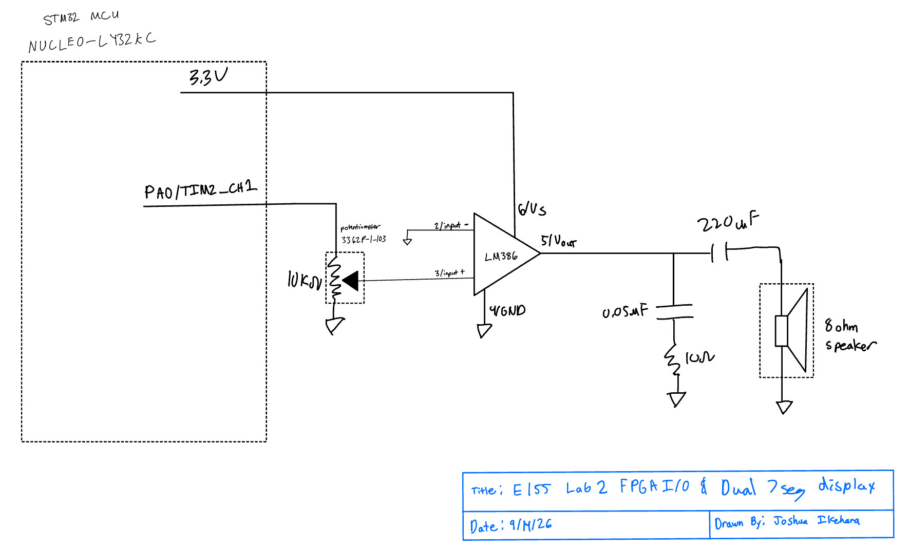
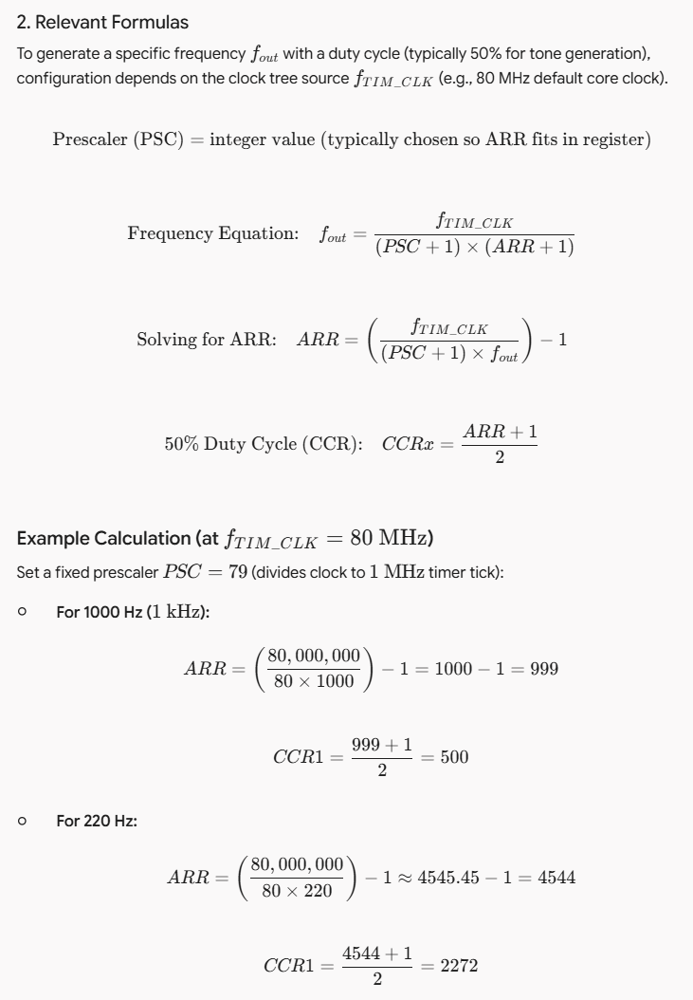
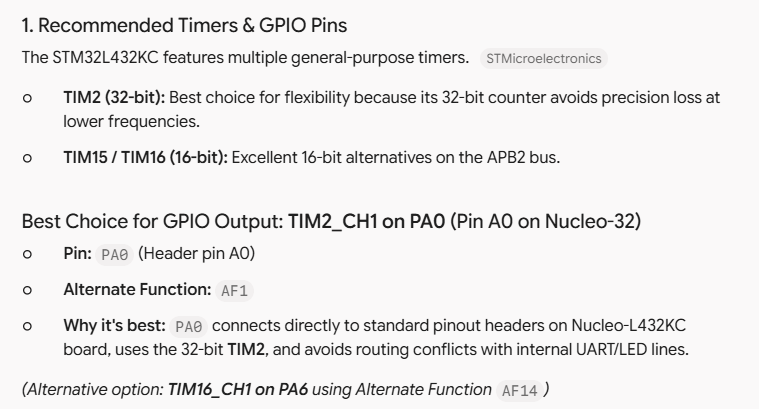
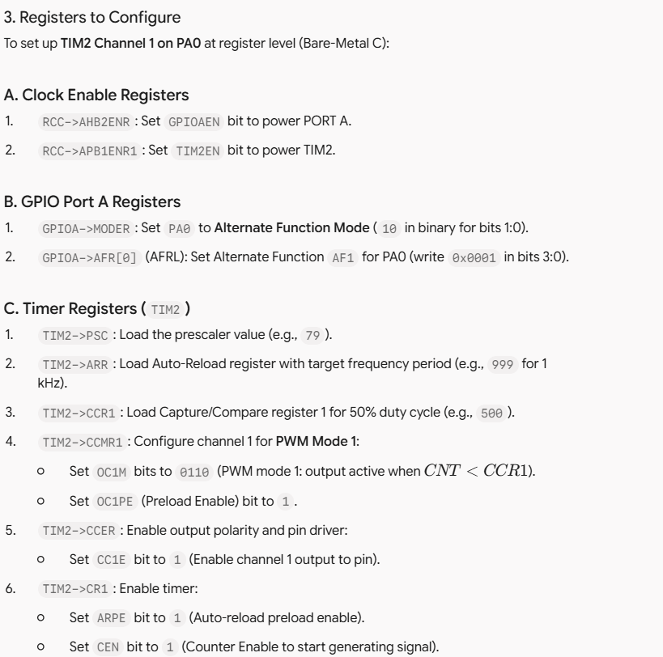

# Introduction
In this lab, a digital audio system was implementated using the STM32L432KC microcontroller, an LM386
audio amplifier, and an 8-ohm speaker. The MCU generate square-wave audio signals using the TIM2 timer
and outputs them through PA0. A second timer, TIM6, is used to control the duration of each note in milliseconds.
The system reads an array containing the pitch and duration of each note and sequentially plays Fur Elise. 
Rests are represented by a frequency of zero and produce silence for the specified duration. 

The system uses the MCU's internal 16MHz HSI oscillator as the timer clock. TIM2 generates the desired
pitch by changing its auto reload register based on the requested frequency, while TIM6 provides a 1kHz timing
reference for note durations. An LM386 amplifier is used to increase the signal level sufficiently to drive the 8-ohm
speaker.

# Design and Testing Methodology

The design was divided into three different components, clock configuration, pitch generation, and note duration control.
First, the MCU was configured to use the 116 MHz HSI16 Oscillator. The `clock_init()` function enables the 
HSI oscillator and configures it as the system clock. The timer calculations therefore use a clock frequency of 16 MHz.

TIM2 was configured to generate the audio waveform on PA0 using channel 1 in PWM mode. PA0 was configured
for alternate function 1, which connects the pin to TIM2 channel 1. The TIM2 prescaler was set to zero, so the timer
receives the full 16 MHz clock. For each note, the program calculate an appropriate divider from the desired
frequency and uses the resulting value to configure the TIM2 auto-reload register. The compare register is set
to approximately half of the period to produce a square wave with approximately 50% duty cycle.
The pitch Calculation is based on: 

$$
f_{out}=\frac{F_{CLK}}{ARR+1}
$$
where $F{CLK=16\text{MHz}}$. The divider is calculated usinig integer roundning: 

$$
div=\operatorname{round}\left(\frac{16,000,000}{f_{target}}\right)
$$

and then sets 

$$
ARR= div-1
$$

Thus, the actual output frequency is 

$$ 
f_{actual}=\frac{16,000,000}{div}
$$

TIM6 was configured seperately as a millisecond timer. Its prescaler is calculated using: 

$$
PSC=\frac{16,000,000}{1000}-1=15999,
$$

giving a 1kHz timer frequency. Therefore, each TIM6 count represents approximately 1 ms. 
The `delay_ms()` function uses this timer to generate the specified duration for each  note.

The program treats a frequency of 0 as a rest. In this case, the TIM2 compare register is set to
zero, preventing divide by zero erros, and preventing the audio signal from being produced while TIM6 
continues counting the duration of the rest. A duration of zero marks the end of the song.

The design was tested first by observing the MCU's output before connecting it to the LM386.
An oscilliscope was used to verify the generated square waves and confirm the output frequency. 
The 220 Hz and 1000 Hz test cases were used to verify the frequency calculations were within 
1% required by the lab specifications. The speaker was then connected after verifying that
the power being supplied to the speaker from the LM386 was at an appropriate level by putting
and 8 ohm resistor to measure the power consumption. 

The complete Fur Elise score was tested to verify that the notes played in the correct order,
that the durations matched the score, and the rest produced silence. The potentiometer was also
tested to verify it could control the output volume.

# Technical Documentation

The source code for this project can be found in the associated GitHub repo: 
it consists of register definitions, the main application code, and the note data used to play fur Elise and Sodapop

## Schematic 

The schematic represents the external components used in the circuit including the MCU output, LM386 amplifier,
potentometer, and 8-ohm speaker. components and connections internal to the MCU are not shown in the schematic.
the appropriate power and ground connections are shown, and all external component values and part numbers are labeled.

{#fig-schematic fig-align="center"}

## frequency calculations

TIM2 uses the 16 MHz HSI clock with a prescaler of zero. The output frequency is therefore: 

$$
f_{out}=\frac{16,000,000}{ARR+1}.
$$

The program calculates a rounded divider according to 

$$
div=\operatorname{round}\left(\frac{16,000,000}{f_{target}}\right)
$$

and sets 

$$
ARR=div-1.
$$

So, for a 440 Hz note, 

$$
div=\operatorname{round}\left(\frac{16,000,000}{440}\right)=36,364.
$$

Thus, 

$$
ARR=36,364-1=36,363
$$

and the resulting frequency is 

$$
f_{actual}=\frac{16,000,000}{36,364}\approx439.996\text{ Hz}.
$$

The frequency error is 

$$
\frac{|439.996-440|}{440}\times100
\approx0.001\%.
$$

This demonstrates how the desired pitch is converted into a timer configuration.

For the required 220 Hz test: 

$$
div=\operatorname{round}\left(\frac{16,000,000}{220}\right)
=72,727
$$ 

giving

$$
f_{actual}=\frac{16,000,000}{72,727}=\approx220.000825\text{ Hz}.
$$

the resulting error is approximately

$$
\frac{|219.999-220|}{440}\times100
\approx0.000375\%
$$

For the required 1000 Hz test: 

$$
div=\operatorname{round}\left(\frac{16,000,000}{1000}\right)
=16,000
$$

and therefore, 

$$
f_{actual}=\frac{16,000,000}{16,000}
=1000\text{ Hz}.
$$

The error is 0%.

Both required test frequencies are therefore within the specified 1% accuracy.

## Fur Elise Frequency accuracy

[Duration Calculation Spreadsheet](https://docs.google.com/spreadsheets/d/1Lk2SUAyXlNmyI0sg6g_ELJxB5OatiOlhHa7MhIFZ5n4/edit?usp=sharing)

To verify the accuracy of all notes in Fur Elise, the entire score and note durations were
evaluated using the same calculations implemented in the C code and shown above. For each target
frequency, the rounded divider, resulting ARR value, actual frequency, and percentage error were calculated.

## Checking only 220 Hz and 1000 Hz is not sufficient 
It's not sufficent because it does not guarantee that every note is within 1% accuracy. The timer is driven 
by a 16 MHz clock and can only use integer divider values, so each desired frequency must be approximated by 
the closest frequency that the timer can generate. Because the timer period can only change in increments of 
one clock cycle, the available frequency resolution depends on the desired frequency. This produces a 
different rounding error for each note, meaning that accuracy at two points in the operating range does not
guarantee accuracy for all other notes. Therefore, every unique pitch used in Für Elise was checked individually 
to verify that its generated frequency is within 1% of the desired frequency.

## Frequency Range
For the theoretical maximum frequency, the smallest usable divider is 2 because thats the smallest number of counter ticks 
to see a complete period of timer counts. 

$$ 
div_{min}=2
$$

Therefore, without changing the clock set ups and keeping the existing code, the max frequency that it supports is

$$
f_{max}=\frac{16,000,000}{2}
=8,000,000\text{ Hz}.
$$

The theoretical minimum frequency is obtained from the largest possible 32-bit timer divider:

$$
div_{max}=2^{32}
$$

giving 

$$
f_{min}=
\frac{16,000,000}{2^{32}}
\approx0.00373\text{ Hz}.
$$

These values represent the theoretical frequency limits of the timer configuration rather than the range of frequencies required for 
musical playback.

## Duration calculations

TIM6 is configured to generate a 1 kHz timing reference. Its prescaler is calculated as

$$
PSC=\frac{16,000,000}{1000}-1
=15,999.
$$

Therefore, each timer count represents approximately

$$
\frac{1}{1000}\text{ s}=1\text{ ms}.
$$

Since TIM6 is a 16-bit timer, the largest value that can be stored in its auto-reload register is 65,535. Because the timer counts from 0 
through the value in ARR, the maximum duration of a single TIM6 interval is 

$$
t_{\max,\text{single}}
=(65,535+1)(1\text{ ms})
=65.536\text{ s}.
$$

The minimum duration is one timer tick:

$$
t_{\min}=1\text{ ms}.
$$

However, the delay_ms() function uses chunking to support durations longer than 65.536 seconds. The variable chunk limits each individual TIM6 interval to 65,536 ms:

uint32_t chunk = (ms > 65536UL) ? 65536UL : ms;

If the requested duration is greater than 65,536 ms, the function repeatedly runs TIM6 and subtracts each completed chunk from ms:

ms -= chunk;

The ms variable is a uint32_t, so the largest duration that can be requested is

$$
t_{\max,\text{chunked}}
=(2^{32}-1)(1\text{ ms})
$$

$$
=4,294,967.295\text{ s}
$$

or approximately 

$$
49.71\text{ days}
$$

Therefore, the system supports durations from 1 ms to 65.536 s per TIM6 interval, while the chunked delay_ms() function can represent durations up to approximately 49.71 days.

# Results and Discussion

The STM32 successfully generated square-wave audio signals using TIM2 and played the provided Für Elise score through the LM386 amplifier 
and 8-ohm speaker. The timer-based pitch generation allowed different frequencies to be produced by changing the TIM2 auto-reload value 
for each note.

The required 220 Hz and 1000 Hz calculations both produced less than 1% frequency error. The additional frequency analysis of the notes 
in Für Elise was used to verify that the timer configuration can reproduce the song's pitches within the required accuracy.

The TIM6 duration timer provided a 1 ms timing resolution, allowing the durations specified by the provided note array to be reproduced 
directly in milliseconds. Rests were handled by setting the TIM2 compare value to zero while continuing to run the duration timer. 
This allowed the system to pause between notes without stopping the timing sequence.

# Conclusion

A digital audio system was successfully implemented using the STM32L432KC, TIM2, TIM6, an LM386 amplifier, and an 8-ohm speaker. TIM2 generated 
the pitches using PWM, while TIM6 provided millisecond-resolution timing for note and rest durations. The provided Für Elise score was successfully 
played with the required pitches, durations, and rests.

The frequency calculations demonstrated that the system can generate both 220 Hz and 1000 Hz within the required 1% accuracy. The additional analysis 
of the unique pitches in Für Elise verified the frequency accuracy across the musical range used by the song. The potentiometer provided volume control, 
and an additional composition was implemented for the Excellence requirement.

The design met the specified hardware, software, calculation, and documentation requirements. I spent a total of 20 working on this lab.

# AI prototype

AI prototype screen shots

I used an LLM to help determine which timer on the STM32L432KC would be appropriate for generating frequencies from 220 Hz to 1 kHz. The LLM pointed me toward TIM2 and suggested using PA0 with TIM2_CH1, which matched the approach I had taken. It also identified the relevant frequency equation and registers, including the prescaler (PSC), auto-reload register (ARR), capture/compare register (CCR1), and GPIO alternate-function configuration. I found the LLM particularly useful for quickly pointing me toward the relevant sections of the reference manual, although I still needed to verify the register names, bit positions, and clock configuration against the actual documentation.

Compared with manually searching the reference manual using Ctrl-F, the LLM was faster at connecting the different pieces together and explaining how they related to one another. However, its initial answer contained incomplete calculations and assumptions about the clock frequency, so I could not rely on it without checking the reference manual. This made the LLM more useful as a documentation navigation and explanation tool rather than as an authoritative source. Overall, the experience showed me that an LLM can significantly reduce the time needed to find relevant information in a complex datasheet, but the information still needs to be verified against the primary documentation before using it in code.
