# Introduction
In this lab, an interupt-driven quadrature encoder system was implented on the STM32L432KC to measure the direction and rotational speed 
of a DC motor. The encoder has two output channels, A and B, which produce phase-shifted square waves as the motor rotates. Both rising and
falling edges of both channels are detected using external interrupts, providing 4x quadrature decoding and a resolution of 480 counts
per motor revolutions assuming we are using a 600 RPM motor.

The system records encoder transitions and records the movement and the timestamp using the interrupt and preforms velocity calculations
in the main loop. A free running TIM2 counter provides micro-seconod resolution time stamps for the encoder edges. The main loop
periodically obtains an atomic snapshot of the encoder count and the time stamp of the most recent edge, then calculate the motor velocity
in milli-revolutions per second and displays the results through the Segger debug terminal. 

# Design and Testing Methodology

# Hardware Design
The motor uses a quadrature encoder with two digital output channels. the encoder outputs were conntected to 
* Channel A ->  PA9
* Channel B -> PA10
Both encoder signals are conncted to EXTII interrupt lines. PA9 uses EXTI line 9 and is handeled using 
`EXTI9_5_IQRHandler(), while PA10 uses EXTI line 10 and is handeled using `EXTI15_10_IQRHandler

The STM32 pins used for the encoder must be 5V tolerant. The encoder outputs were therefore coonnected only to appropriate 5V tolerant MCU pins.
PA9 and PA10 were selected because they are listed as 5 V-tolerant GPIO pins in the STM32L432KC datasheet.

The motor itself was powered seperately from the STM32 using a power supply to get to higher voltages it requires to run as well as change the voltages
to affect the rev/s.

the encoder resolution is: 

$$
120\text{ pulses/revolution}\times4\text{ edges/pulse}
=480\text{ counts/revolution}
$$

Therefore, 

$$
\boxed{N_{\mathrm{counts/rev}}=480}
$$

The `COUNTS_PER_REV` constant in the program should therefore evaluate to 480

## Interrupt configuration

The encoder pins are configured as digital inputs. SYSCFG is used to connect the GPIO pins to their corresponding EXTI lines. Both rising and falling edges are enabled
with RTSR1 and FTSR1 for each EXTI line. This provides four encoder transitions for every encoder pulse. Using both edges of both channels provides the highest possible
quadrature resolution. The two EXTI interupt sources are enabled in the NVIC. The more computationally expensive velocity calculations aren't preformed in the interrupt 
handelers and they only update the state, position count, invalid transition count, and timestamp. 

## Quadrature Decoding

The currend encoder state is represented by two bits: 

$$
\text{state}={A,B}
$$

The previous and current states are used as a four-bit table index: 

$$
\text{index}=(\text{previous state}\ll2)+\text{current state}
$$

the program uses the following 

### Quadrature State Sequence

For the direction corresponding to a positive encoder count, the valid
quadrature sequence is:

$$
00 \rightarrow 10 \rightarrow 11 \rightarrow 01 \rightarrow 00
$$

Each transition produces a count of $+1$:

| Transition | Table Index | Step |
|:----------:|:-----------:|:----:|
| 00 → 10 | 2  | +1 |
| 10 → 11 | 11 | +1 |
| 11 → 01 | 13 | +1 |
| 01 → 00 | 4  | +1 |

For the opposite direction, the sequence is:

$$
00 \rightarrow 01 \rightarrow 11 \rightarrow 10 \rightarrow 00
$$

Each transition produces a count of $-1$:

| Transition | Table Index | Step |
|:----------:|:-----------:|:----:|
| 00 → 01 | 1  | -1 |
| 01 → 11 | 7  | -1 |
| 11 → 10 | 14 | -1 |
| 10 → 00 | 8  | -1 |

the remaining states are either no change or invalid change to get the full truth table of 
### Quadrature Decoder State Table

The encoder has two channels, A and B, which together form a two-bit state. 
Each encoder edge causes a transition from one state to another. The previous 
and new states are combined to form a 4-bit index into the quadrature step table.

| Previous State | New State | Index | QUADRATURE_STEP_TABLE value |  Meaning |
|:--------------:|:---------:|:-----:|:------------------------------:|:--------|
| 00 | 00 | 0  |  0  | No change |
| 00 | 01 | 1  | -1  | Reverse direction |
| 00 | 10 | 2  | +1  | Forward direction |
| 00 | 11 | 3  |  0  | Invalid transition |
| 01 | 00 | 4  | +1  | Forward direction |
| 01 | 01 | 5  |  0  | No change |
| 01 | 10 | 6  |  0  | Invalid transition |
| 01 | 11 | 7  | -1  | Reverse direction |
| 10 | 00 | 8  | -1  | Reverse direction |
| 10 | 01 | 9  |  0  | Invalid transition |
| 10 | 10 | 10 |  0  | No change |
| 10 | 11 | 11 | +1  | Forward direction |
| 11 | 00 | 12 |  0  | Invalid transition |
| 11 | 01 | 13 | +1  | Forward direction |
| 11 | 10 | 14 | -1  | Reverse direction |
| 11 | 11 | 15 |  0  | No change |

A valid clockwise or counterclockwise transition changes the encoder count by either +1 or -1 A transition in which both encoder
channels appear to change simultaneously is treated as an invalid transition. The encoder position is therefore accumulated using

g_count += step

The change in count determines direction :
*positive velocity $\rightarrow$ CW
*negative velocity $\rightarrow$ CCW
*zero velocity $\rightarrow$ ---

A positive encoder step produces positive velocity and corresponds to CW rotation in this implementation, while a negative step produces negative velocity and corresponds to CCW rotation.

## Velocity Calculation

The velocity calculation uses the change in encoder counter and the teim between encoder edges. The fundamental relationship is

$$
\text{rev/s}=\frac{\Delta\text{counts}}
{\text{counts/rev}\times\Delta t}
$$

where $\Delta t$ is measured in seconds.

Since the program stores velocity in milli-revolutions per second, the implementation uses:
$$
\frac{
\Delta C\times10^6\times10^3
}{
\Delta t_{\mu s}\times\text{pulses per revolution}\times 4
}
$$

Therefore:

$$
\frac{\Delta C\times10^9}
{\Delta t_{\mu s}\times\text{pulses per revolution}\times 4}
$$

The resulting value is converted back to milli-revolutions per second.

For example, for the 600 RPM motor that has 120 pulses per revolution with 4 different edges which makes it 480 counts per revolution.
if that has 960 counts in 1 second:

$$
v=
\frac{960}{480(1)}
=2\text{ rev/s}
$$

Therefore the program reports:

Speed: 2.000 rev/s

A negative count change produces a negative velocity and therefore indicates the opposite direction.

## Main Loop and Update rather

The main loop does not poll the encoder pins. Instead, the encoder is detected exclusively though EXTI interrupts. The main loop waits
250 ms between reports therefore, the reporting frequency is 

$$
f_{\mathrm{report}}=
\frac{1}{0.250}
=4\text{ Hz}
$$

Thus, since 4 Hz exceeds the minimum update rate of 1 Hz.

the interrupts are disabled while the shared values are copied to prevent them from changing while it's being taken and velocity calculations 
are preformed outside of the interrupt handelers in the main program. 

## Resolution of measurement achieved

Two different types of resolution are important to the velocity measurement system encoder resolution and time resolution. The encoder resolution 
determines how much rotational motion is represented by each detected encoder transition, while the time resolution determines how precisely the 
time between transitions can be measured.

The motor encoder produces 120 pulses per revolution. Because the system uses 4x quadrature decoding, both the rising and falling edges of both encoder 
channels are detected. Therefore, each encoder pulse produces four countable transitions:

$$
N_{\mathrm{counts/rev}} = 120\ \frac{\mathrm{pulses}}{\mathrm{rev}}
\times 4\ \frac{\mathrm{counts}}{\mathrm{pulse}}
= 480\ \frac{\mathrm{counts}}{\mathrm{rev}}
$$

Thus, the encoder resolution is:

$$
\boxed{480\ \mathrm{counts/rev}}
$$

or, equivalently, each encoder count represents:

$$
\frac{1}{480}\ \mathrm{rev/count}
\approx 0.002083\ \mathrm{rev/count}
$$

The time resolution is determined separately by TIM2. The timer is configured to run at 1 MHz, giving one timer tick every 1 $\mu$s:

$$
T_{\mathrm{tick}} = \frac{1}{1,\mathrm{MHz}}
= 1\ \mu\mathrm{s}
$$

Therefore, the system can measure the time between encoder transitions with a resolution of approximately 1 $\mu$s. The timer resolution does not determine the encoder's rotational resolution. Instead, the two resolutions work together when calculating velocity. The encoder count determines the amount of rotation, while the timestamp difference determines how long that rotation took.

The velocity is calculated from the change in encoder count and the elapsed time between encoder transitions:

$$
v =
\frac{\Delta C}{480}
\frac{1}{\Delta t}
$$

where $\Delta C$ is the change in encoder count and $\Delta t$ is the elapsed time in seconds. In the implementation, $\Delta t$ is measured in microseconds and the result is scaled to milli-revolutions per second. This allows the system to use the encoder's 480 counts/revolution resolution together with TIM2's 1 $\mu$s time resolution to determine the motor's rotational speed.
The effective velocity resolution depends on the measurement interval, since one encoder count represents (1/480) revolution and the elapsed time determines the corresponding rotational speed.

## Low Speed Operation

the velocity algorithm is designed to continue to produce a nonzero velocity when the motor is moving slowly. The program doesn't require an encoder edge
during every 250 ms reporting interval. Instead, it remembers the timestamp of the most recent encoder edge. When another edge occurs, the velocity is calcualted 
using the time between the two measured edges. This is particularly useful at low speeds becasue a fixed window measurement could easily observe zero counts during a short
measurement interval eventhough the motor is still moving. The resolution comes from the fact that there are 120 pulses/ revolution and since we have 
One quadrature cycle:

A rising
A falling
B rising
B falling

This means that there are 4 detectable transitions so the 120 pulses per revolutiono turns into 

$$
120\text{ pulses/rev}\times4
=
480\text{ counts/rev}

$$

Thus, for the smallest amount of 

For example, at 1 count per second:
$$
v=
\frac{1}{480}
\approx0.00208\text{ rev/s}
$$

Therefore, the encoder resolution allows very small rotational speeds to be detected.

The software also includes a one-second zero-speed timeout. If no encoder edge has occurred for more than one second, the reported velocity is set to zero. This allows 
the system to distinguish a stopped motor from a motor whose previous velocity measurement should simply be retained.

# Technical Documentation

## Software 

The source code for the project can be found in the associated Github repository.

The encoder module is responsible for GPIO, EXTI, NVIC, quadrature decoding, encoder position, and edge timestamps.

The timestamp module configures TIM2 as a 1 MHz free-running timer.

The velocity module converts encoder count and timing information into signed velocity.

The main module initializes the system, periodically obtains encoder snapshots, calculates velocity, and prints the results.

## Flow Chart

The system operates primarily through interrupt handlers that detect changes in the encoder inputs. When an edge occurs, the handler reads the current states of both encoder 
channels and uses the state transition to determine the direction and step. It also records the timestamp of the edge. This count and timing data is then used by the velocity
 calculation, while the main loop periodically processes and reports the results every 250 ms.
The overall architecture can be represented as follows

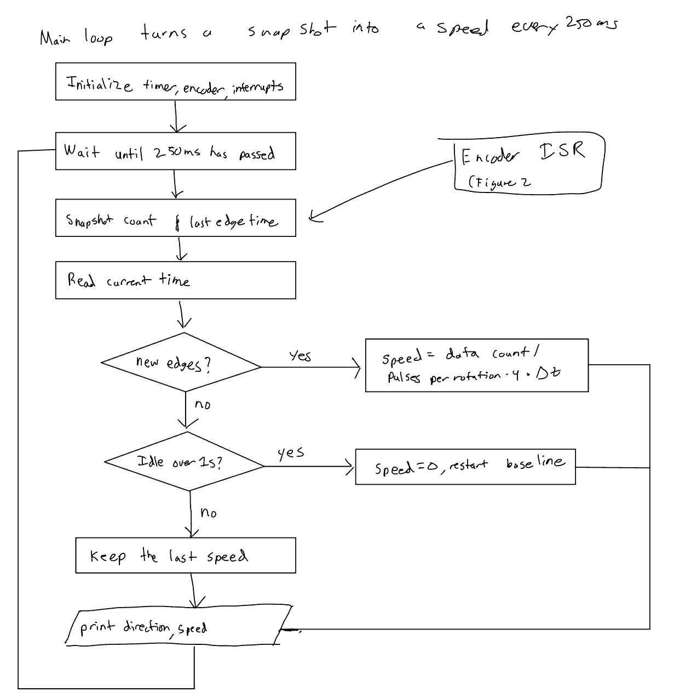{#fig-schematic fig-align="center"}

The interrupt and main-loop communication can be represented by the following flow:

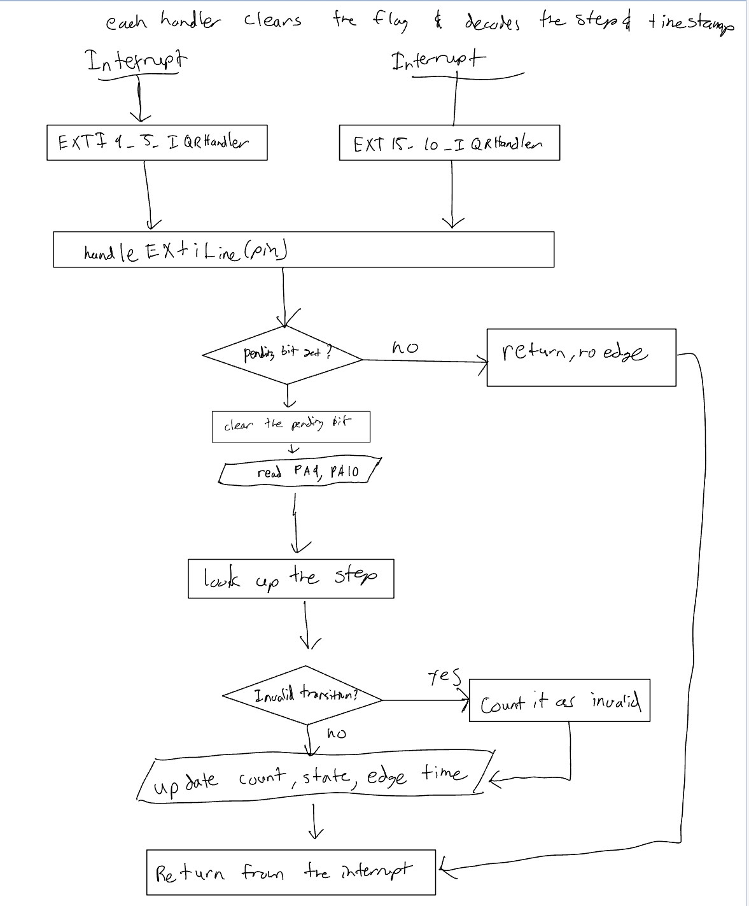{#fig-schematic fig-align="center"}

The last chart is the decision logic inside velocityUpdate(), which main calls on each report.

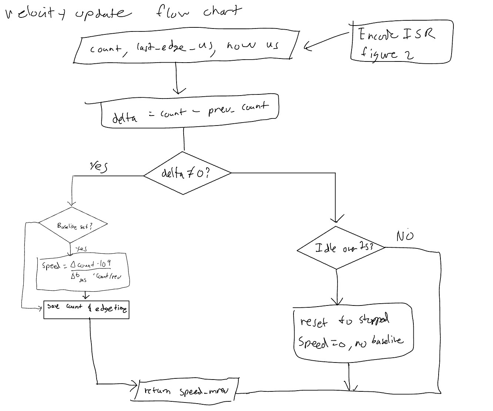{#fig-schematic fig-align="center"}


## Schematic

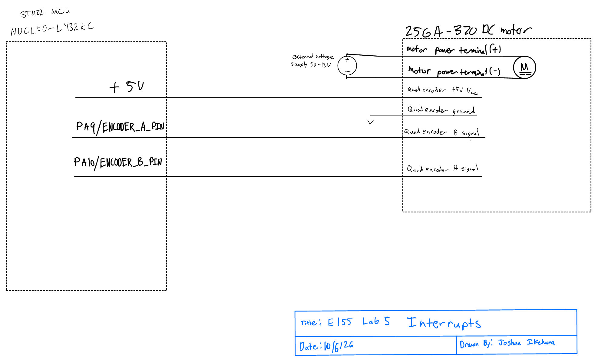{#fig-schematic fig-align="center"}

The schematic shows the DC gear motor and its integrated quadrature encoder. The motor is powered separately from the microcontroller, 
while the encoder provides the feedback signals used for speed and direction measurement. Encoder channels A and B are connected to PA9 
and PA10 on the STM32L432KC, respectively. The encoder is also connected to its required power and ground connections. The schematic 
separates the motor power connections from the encoder signal connections to clearly show that the microcontroller monitors the encoder 
outputs rather than directly driving the motor.


# Results and Discussion

The accuracy of the revolutions/s was determined by hooking up an osciliscope to one of the output channels of the encoder and measuring the frequency
since we know that there is 120 pulses per revolution, dividing the frequency by the pulses per revolution gives us the revolutions per second. we did three test points
for both the cw and ccw directions. The oscilloscope measurement provides a shorter-time measurement using only one encoder channel, while the MCU uses individual encoder transitions and their timestamps to calculate velocity. As a result, small differences between the two measurements can occur due to the different measurement intervals and methods.

CCW

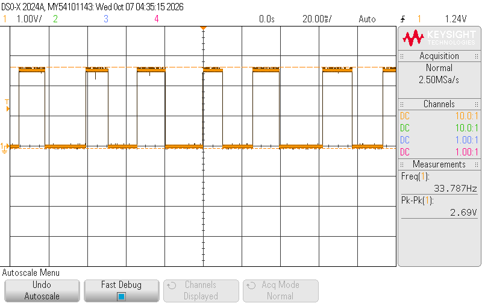{#fig-schematic fig-align="center"}

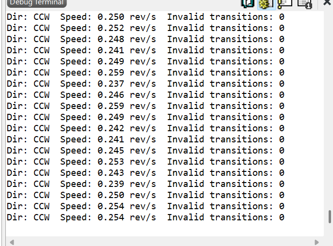{#fig-schematic fig-align="center"}

The oscilloscope measured an encoder frequency of 33.787 Hz, giving a motor speed of

$$
\frac{33.787}{120} = 0.2815\ \mathrm{rev/s}.
$$

The MCU reported $0.254\ \mathrm{rev/s}$, which is pretty close to the oscilliscope measurement.

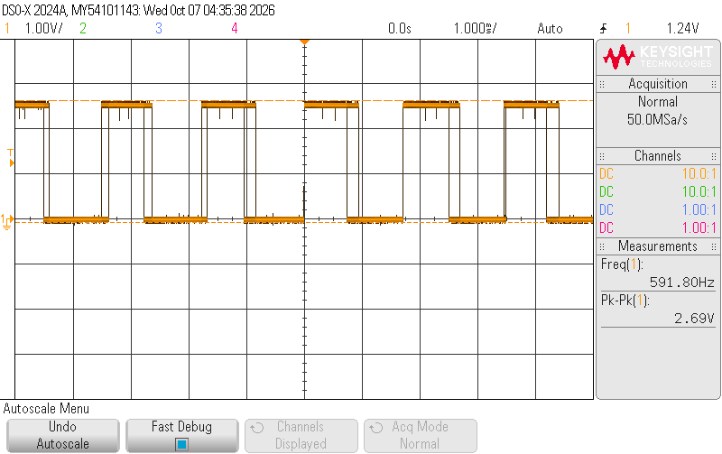{#fig-schematic fig-align="center"}

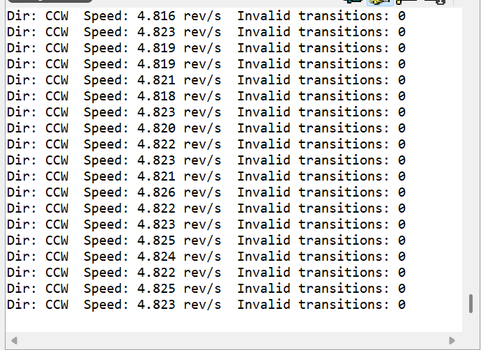{#fig-schematic fig-align="center"}

The oscilloscope measured an encoder frequency of 591.80 Hz, giving a motor speed of

$$
\frac{591.80}{120} = 4.931\ \mathrm{rev/s}.
$$

The MCU reported $4.825\ \mathrm{rev/s}$, which is pretty close to the oscilliscope measurement.


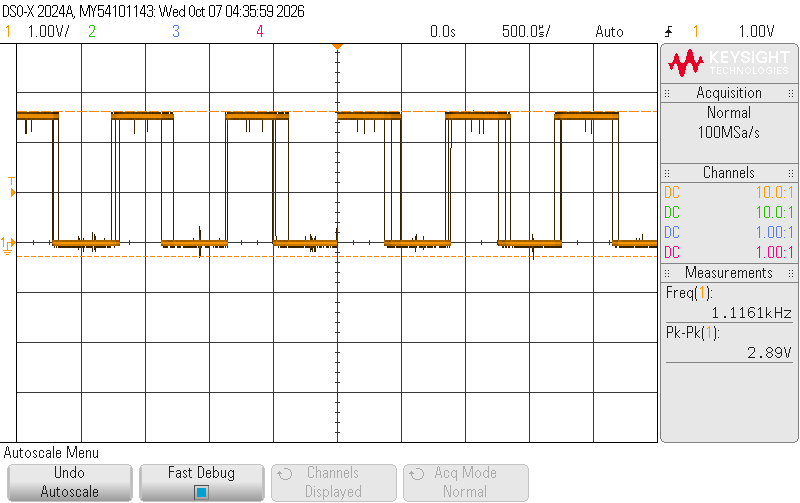{#fig-schematic fig-align="center"}

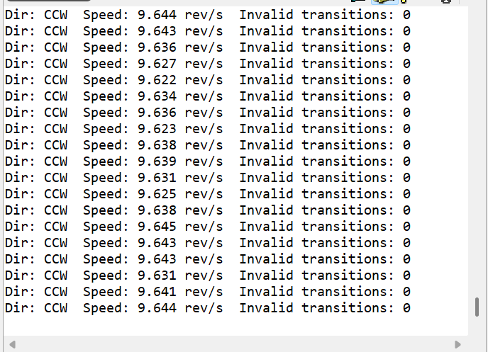{#fig-schematic fig-align="center"}

The oscilloscope measured an encoder frequency of 1.1161 kHz, giving a motor speed of

$$
\frac{1116.1}{120} = 9.301\ \mathrm{rev/s}.
$$

The MCU reported $9.644\ \mathrm{rev/s}$, which is pretty close to the oscilliscope measurement.


Now looking at the opposite directiono of CW

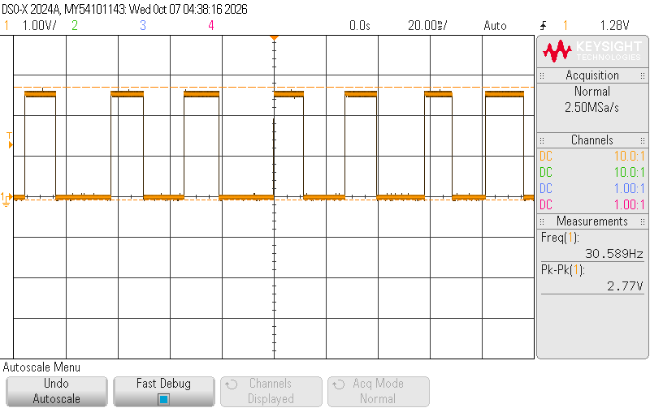{#fig-schematic fig-align="center"}

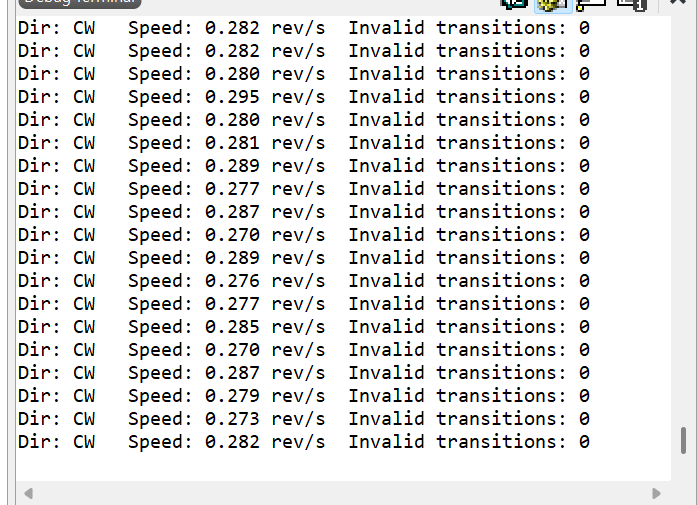{#fig-schematic fig-align="center"}


The oscilloscope measured an encoder frequency of 30.589 Hz, giving a motor speed of

$$
\frac{30.589}{120} = 0.254\ \mathrm{rev/s}.
$$

The MCU reported $0.273\ \mathrm{rev/s}$, which is pretty close to the oscilliscope measurement.


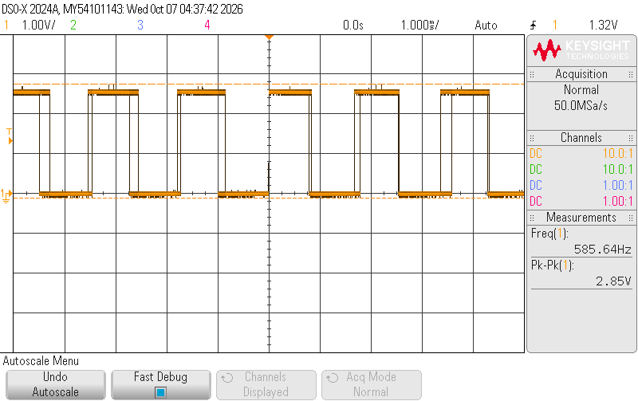{#fig-schematic fig-align="center"}

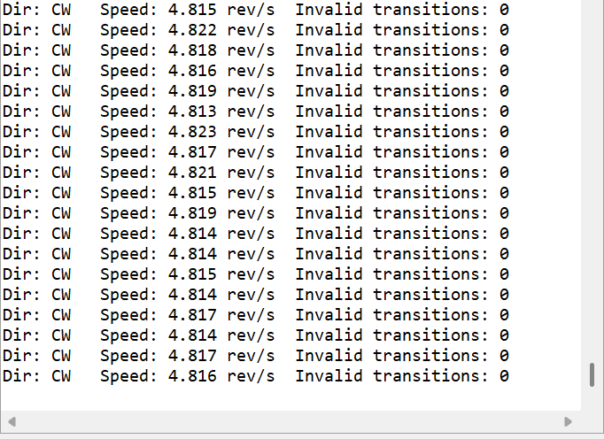{#fig-schematic fig-align="center"}

The oscilloscope measured an encoder frequency of 585.64 Hz, giving a motor speed of

$$
\frac{585.64}{120} = 4.88\ \mathrm{rev/s}.
$$

The MCU reported $4.823\ \mathrm{rev/s}$, which is pretty close to the oscilliscope measurement.


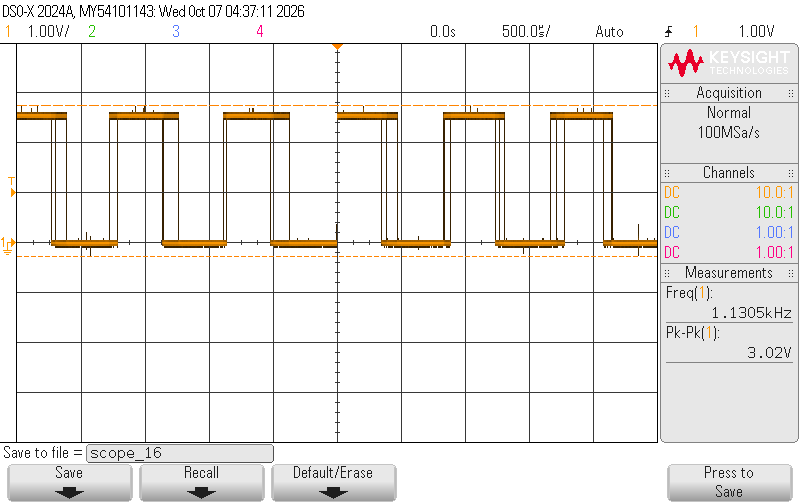{#fig-schematic fig-align="center"}

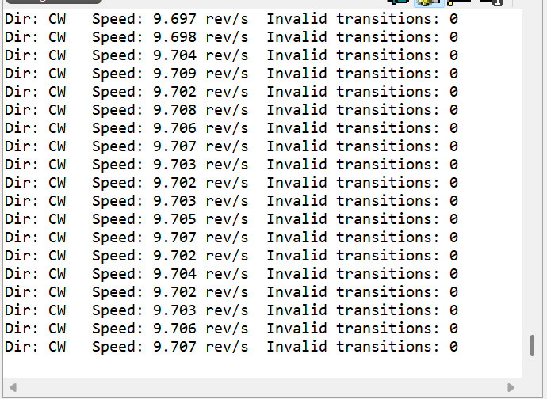{#fig-schematic fig-align="center"}

The oscilloscope measured an encoder frequency of 1.1305 kHz, giving a motor speed of

$$
\frac{1130.5}{120} = 9.4208\ \mathrm{rev/s}.
$$

The MCU reported $9.707\ \mathrm{rev/s}$, which is pretty close to the oscilliscope measurement.

## interrupt-based code vs manual polling at high speeds

{#fig-schematic fig-align="center"}

At 12 V, the oscilloscope measured an encoder frequency of 1.19 kHz on one channel, corresponding to $1190/120 = 9.92 \text{rev/s}$. 
With 4x quadrature decoding, this produces $1190(4) = 4760 \text{transitions/s}$, or approximately one transition every $210.1\ \mu\mathrm{s}$. 
An interrupt-based implementation can respond to each transition using the EXTI hardware, whereas a polling implementation must repeatedly check 
the encoder inputs faster than the $210.1\ \mu\mathrm{s}$ transition period to avoid missing transitions. Missing transitions would cause the measured 
encoder count to be lower than the true count, resulting in an underestimated motor speed and potentially incorrect direction information if transitions 
are missed inconsistently. Therefore, interrupt-based detection provides more reliable pulse detection at high speeds, while polling requires continuous 
CPU activity and becomes more susceptible to missed transitions as the motor speed increases. The tradeoff is that each interrupt requires some processing 
time, so the interrupt handler must remain short enough to keep up with the encoder transitions. The interrupt-based approach avoids relying on a fixed polling 
rate because the EXTI hardware detects each configured edge and calls the interrupt handler. This provides a more reliable method for capturing encoder transitions 
at high speed, while polling has the advantage of simpler continuous sampling but requires the processor to repeatedly check the inputs.


# Conclusion

The lab 5 encoder system successfully implements an interupt driven quadrature encoder measurement system for the STM32L432KC. Both encoder channels are connected to EXTI interrupts, and Both
rising and falling edges are detected to provide 4x quadrature decoding. With a 120 pulse per revolution encoder, the system achieves 480 counts/revolution.

the TIM2 provides a 1 MHz free running timestamp, giving 1 µs timing resolution forencodertransitions. The velocity calculatin uses the change in encoder count andtime between encoder edges,
allowing the system to measure slow motoro speeds without relying on a fixed measurement window.

The main loop reports the motor speed every 250 ms, corresponding to a 4 Hz update rate. A one-second no-edge timeout causes the reported velocity to become zero when the motor stops. The interrupt
handelers remain small by limiting their responsibilites to clearing the interrupt, decoding the encoder state, updating the count, and recording the timestamp.

The software therefore meets the core interrupt-driven design requirements and the architectural requirements for excellence, including 4× quadrature decoding and low-speed timing-based velocity measurement.

This lab took be 17 hours.

# AI Prototype Reflection

I used an LLM to generate code for interfacing a quadrature encoder with the STM32L432KC. Instead of using GPIO external interrupts like my original design, the LLM used the **TIM2 hardware encoder mode** to decode the two encoder signals. It configured both timer input channels with `TIM_ENCODERMODE_TI12` and then used a timer update interrupt to keep track of overflows and underflows. The code also included a function to calculate the total encoder position by combining the timer count with the overflow count.

The generated code was useful for showing another possible approach, but it did not directly match the requirements or setup of my implementation. The LLM relied heavily on the STM32 HAL library, while my lab code directly configures the STM32 registers and uses GPIO external interrupts. I also had to verify that the proposed timer and pins were actually appropriate for the hardware. Overall, I found the LLM more useful as a **sounding board for alternative approaches** than as a code generator that could be used without modification. It quickly produced a plausible implementation, but understanding the generated code and checking it against the lab requirements was still necessary.

<details>
<summary>Expand to view the LLM-generated code</summary>

```c
TIM_Encoder_InitTypeDef sConfig = {0};
TIM_MasterConfigTypeDef sMasterConfig = {0};

htim2.Instance = TIM2;
htim2.Init.Prescaler = 0;
htim2.Init.CounterMode = TIM_COUNTERMODE_UP;
htim2.Init.Period = 65535;
htim2.Init.ClockDivision = TIM_CLOCKDIVISION_DIV1;

sConfig.EncoderMode = TIM_ENCODERMODE_TI12;
sConfig.IC1Polarity = TIM_ICPOLARITY_RISING;
sConfig.IC1Selection = TIM_ICSELECTION_DIRECT_TI;
sConfig.IC1Prescaler = TIM_ICPSC_DIV1;
sConfig.IC1Filter = 10;

sConfig.IC2Polarity = TIM_ICPOLARITY_RISING;
sConfig.IC2Selection = TIM_ICSELECTION_DIRECT_TI;
sConfig.IC2Prescaler = TIM_ICPSC_DIV1;
sConfig.IC2Filter = 10;

HAL_TIM_Encoder_Init(&htim2, &sConfig);

HAL_TIM_Encoder_Start(&htim2, TIM_CHANNEL_ALL);

__HAL_TIM_ENABLE_IT(&htim2, TIM_IT_UPDATE);

volatile int32_t encoder_overflow_count = 0;

void HAL_TIM_PeriodElapsedCallback(TIM_HandleTypeDef *htim) {
    if (htim->Instance == TIM2) {
        if (__HAL_TIM_IS_TIM_COUNTING_DOWN(&htim2)) {
            encoder_overflow_count--;
        } else {
            encoder_overflow_count++;
        }
    }
}

int64_t Get_Encoder_Position(void) {
    uint16_t timer_count = __HAL_TIM_GET_COUNTER(&htim2);
    return ((int64_t)encoder_overflow_count * 65536) + timer_count;
}
```

</details>