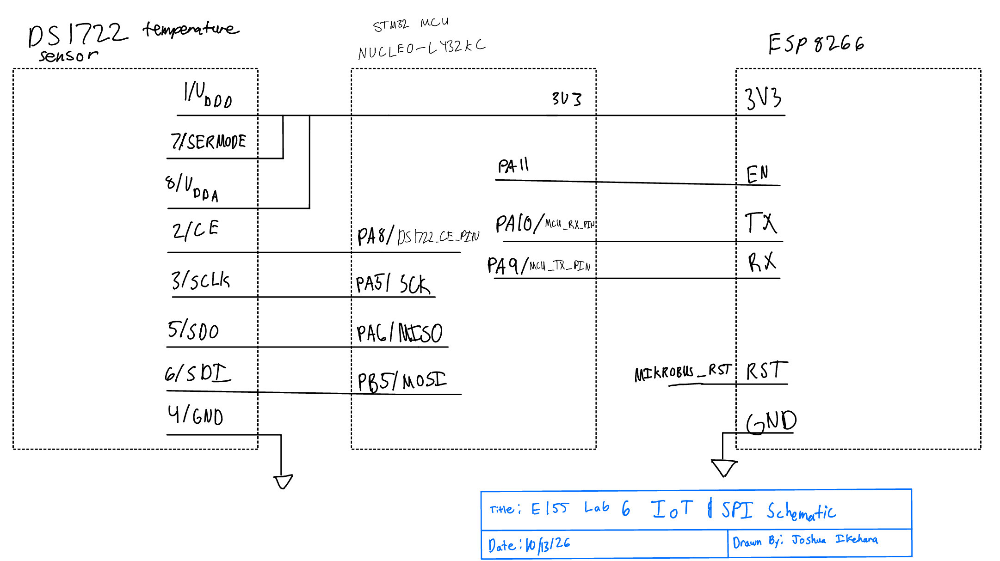
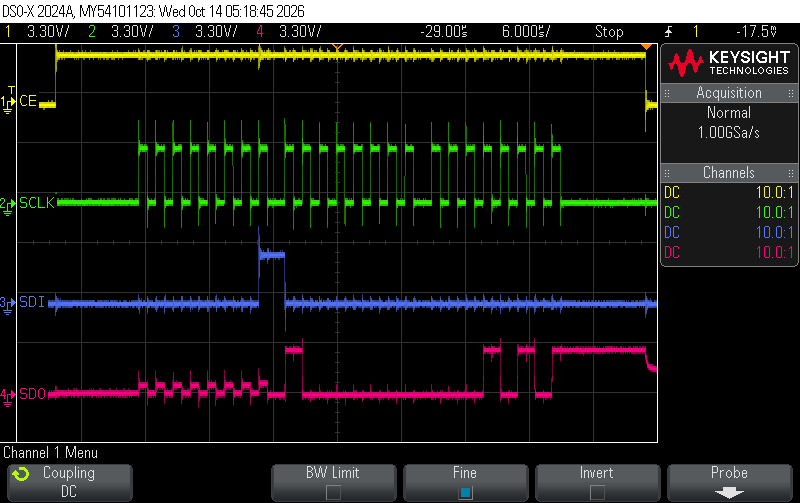
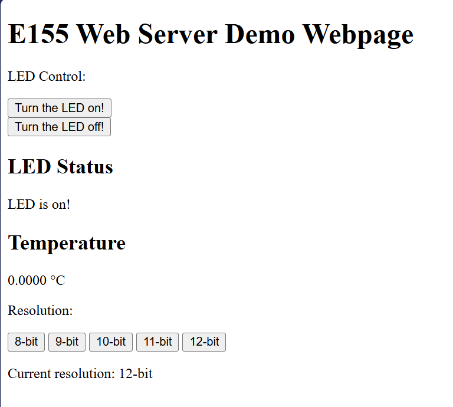
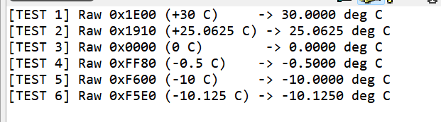
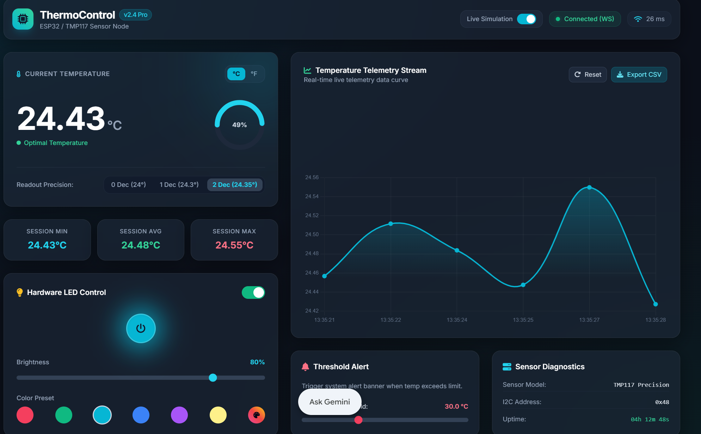

# Introduction
The objective of Lab 6 was to develp an Internet of Things (IoT) device using an STM 32L432KC microcontroller, a DS1722 digital temperature sensor, and an ESP8266
Wi-Fi module. The device was designed to measure ambient temperature, control onboard LED thruogh a webpage, and allow the user to configure the sensor's
measurement resolution.

The microcontroller communicates with the DS1722 using the Serial Peripherial Interface (SPI) and communicates with the ESP8266 using Universal Asynchronous 
Receiver-Transmitter (UART) connection. The ESP8266 hosts a web server that receives browser requests and forwards them to the microcontroller.
The microcontroller interprets these requests, updataes the LED or temperature sensor configuration, reads the current temperature, and returns an HTML webpage
containing the latest information. 

A primary focus of the lab was implementinig an SPI driver using the CMSIS device register defintions in `stm32l432xx.h` rather than relying on an external device
driver. An osciliscope was used to examine the SPI transaction and compare the observed communication with the DS1722 datasheet. 

# Design and Testing Methodology
## Hardware Design

The Hardware consists of three main components, STM32L432KC development board, the DS1722 temperature sensor on an SOIC-8 breakout board, and the ESP8266 Wi-Fi module.
The STM32L432KC serves as the central controller. It communicates with the DS1722 over SPI, drives the onboard LED through GPIO, and exchanges requests and webpage data
with the ESP8266 over UART.

The DS1722 uses a chip-enable (CE) signal to identify the beginning and end of a communication transaction. The SPI clock and data signals are connected to the microcontroller's
SPI1 peripheral. The ESP8266 operates at 3.3 V and communicates with the microcontroller through crossed TX and RX connections.

The FPGA was disconnected from shared microcontroller pins by setting the relevant DIP switches to the open position. This prevents the FPGA from interfering with the GPIO
and peripheral signals.

The connections used in the software are summarized below.

| Signal                | STM32L432KC pin | Function                        |
|:----------------------|:---------------:|:--------------------------------|
| DS1722 CE              | PA8             | Selects the temperature sensor  |
| SPI SCK                | PA5             | SPI clock                       |
| SPI MISO / sensor SDO  | PA6             | Sensor-to-MCU data              |
| SPI MOSI / sensor SDI  | PB5             | MCU-to-sensor data              |
| ESP8266 UART TX        | PA9             | MCU transmits to ESP8266 RX     |
| ESP8266 UART RX        | PA10            | MCU receives from ESP8266 TX    |
| Onboard LED            | PB3             | LED control output              |


# Technical Documentation
The source code for the project can be found in the associated [Github](https://github.com/joshuaikehara/e155-lab1/tree/main/lab6_JI)

## source code organization

the soruce code is organized into the following modules

| File | Purpose |
|---|---|
| `main.c` | Initializes the system and implements the application loop and webpage generation |
| `main.h` | Defines pin assignments and includes the required libraries |
| `DS1722.c` | Implements the temperature sensor driver |
| `DS1722.h` | Defines the DS1722 register addresses and function prototypes |
| `STM32L432KC_SPI.c` | Implements SPI1 configuration and byte transfers using CMSIS registers |
| `STM32L432KC_SPI.h` | Declares the SPI driver interface |
| `STM32L432KC_GPIO.c` | Implements GPIO configuration and digital input/output |
| `STM32L432KC_GPIO.h` | Defines GPIO pin assignments and function prototypes |
| `STM32L432KC_USART.c` | Implements UART initialization and character/string communication |
| `STM32L432KC_USART.h` | Declares the USART driver interface |
| `STM32L432KC_RCC.c` | Configures the system clock |
| `STM32L432KC_RCC.h` | Declares the clock configuration functions |
| `STM32L432KC_TIM.c` | Provides timer initialization and delay functions |
| `STM32L432KC_TIM.h` | Declares the timer interface |
| `STM32L432KC_FLASH.c` | Configures flash latency and prefetch |
| `STM32L432KC_FLASH.h` | Declares the flash configuration function |

## Circuit Schematic

{#fig-schematic fig-align="center"}


The schematic represents only the external components and wiring added to the development board. The onboard microcontroller, LED circuitry, and other motherboard components are 
not redrawn. Their relevant connections are referenced in the [E155 development board schematic](https://hmc-e155.github.io/assets/doc/E155%20Development%20Board%20Schematic.pdf).

The DS1722 is shown on its SOIC-8 breakout board, with the sensor power, ground, CE, SCK, SDO, and SDI connections labeled. The ESP8266 is shown with its 3.3 V supply, ground, TX, 
and RX connections. The UART connections are crossed between the microcontroller and the ESP8266.

## SPI Transactioon and Register Access

The DS1722 communicates using serial transfers consisting of a register address followed by one or more data bytes. The microcontroller asserts CE to begin a transaction and clocks data into
and out of the sensor using SCLK.

For a temperature read, the software starts at the temperature LSB register, transfers the address, and clocks out the two temperature bytes. The recieved bytes are combined into a 16 bit value.

Timing annotations that are important from the data sheet vs what was measured

{#fig-schematic fig-align="center"}


## Webpage Implementation
The webpage is assembled from HTML strings defined in main.c. The webpageStart and webpageEnd strings define the beginning and end of the HTML document. Additional strings provide the LED controls and resolution-selection buttons.

The LED controls submit requests to the ledon and ledoff endpoints. The resolution controls submit requests to res8, res9, res10, res11, and res12.

When the microcontroller receives a request, it processes the command before reading the temperature and transmitting the updated page. The response contains the LED state, the current 
temperature in degrees Celsius, and the resolution reported by the software.

The ESP8266 expects a complete HTML document and terminates the response when it receives </html> or when the specified inter-byte timeout expires.

{#fig-schematic fig-align="center"}


# Results and Discussion

## Temperature and Formatting Timestamps

The runSoftwareTests() function tests the temperature formatting routine using known raw values. These tests check whether the conversion produces the expected positive, zero, and negative temperatures.

These values test the numerical conversion independently of the physical sensor (since we aren't able to test at -10$^\circ$). The expected values correspond to interpreting the raw register contents as 
a signed 8.8 fixed-point number.

<details><summary> click to view the serial console output from runSoftwareTests()</summary>

{#fig-schematic fig-align="center"}

</details>

## LED Control 

The LED is controlled through the updateLEDStatus() function. When the received request contains ledon, the function sets LED_PIN high. When the request contains ledoff, it sets the pin low.

After processing the command, the application reads the LED pin and uses the resulting state to generate the status displayed on the webpage.

## Temperature Resolution Selection

The webpage provides controls for selecting 8-, 9-, 10-, 11-, and 12-bit sensor resolution. The updateResolution() function interprets the corresponding request, and ds1722SetResolution() attempts to
configure the sensor through its configuration register.

The driver maintains a software variable called currentResolution. This variable is used to avoid unnecessary configuration writes and to determine the number of decimal places shown by the formatting function.

However, the software variable alone does not prove that the sensor has accepted the configuration. The register value should be checked through ds1722ReadConfig().

# Conclusion

Lab 6 combines embedded software, serial communication, sensor interfacing, and a web-based user interface in a single IoT system. The design uses the STM32L432KC microcontroller 
to communicate with the DS1722 temperature sensor over SPI, control an onboard LED through GPIO, and exchange requests and HTML responses with the ESP8266 over UART.

The SPI driver is implemented using the CMSIS register definitions, and the DS1722 driver provides functions for register access, temperature acquisition, and temperature formatting. 
The main application processes LED and resolution requests and constructs a webpage containing the sensor data and hardware status.

The final design meets all the proficiency and excellence requirements for Lab 6. The DS1722 temperature sensor communicates with the STM32L432KC through a custom SPI driver implemented using CMSIS register 
definitions. The device integrates temperature measurement with the ESP8266 web interface, allowing temperature readings to be displayed and the onboard LED to be controlled through the webpage. The design 
also supports selecting the DS1722 temperature resolution through the web interface. The SPI communication was documented using a labeled oscilliscope capture and evaluated against the timing requirements 
specified in the DS1722 datasheet. The circuit schematic documents the physical off-board connections, and the technical documentation describes the overall system design.

Total time spent: {15 Hrs}

# AI Prototype summary
<details>
<summary>Expand to view the LLM-generated code for website HTML</summary>

{#fig-schematic fig-align="center"}

```HTML

<!DOCTYPE html>
<html lang="en" class="dark">
<head>
    <meta charset="UTF-8">
    <meta name="viewport" content="width=device-width, initial-scale=1.0">
    <title>IoT ThermoControl Hub</title>
    <!-- Tailwind CSS CDN -->
    <script src="https://cdn.tailwindcss.com"></script>
    <!-- Chart.js CDN -->
    <script src="https://cdn.jsdelivr.net/npm/chart.js"></script>
    <!-- FontAwesome for Icons -->
    <link rel="stylesheet" href="https://cdnjs.cloudflare.com/ajax/libs/font-awesome/6.4.0/css/all.min.css">
    <!-- Inter Font -->
    <link href="https://fonts.googleapis.com/css2?family=Inter:wght@300;400;500;600;700&display=swap" rel="stylesheet">
    <script>
        tailwind.config = {
            darkMode: 'class',
            theme: {
                extend: {
                    fontFamily: { sans: ['Inter', 'sans-serif'] },
                    colors: {
                        dark: {
                            bg: '#0f172a',
                            card: 'rgba(30, 41, 59, 0.7)',
                            border: 'rgba(255, 255, 255, 0.08)'
                        },
                        neon: {
                            cyan: '#06b6d4',
                            emerald: '#10b981',
                            amber: '#f59e0b',
                            rose: '#f43f5e'
                        }
                    }
                }
            }
        }
    </script>
    <style>
        body {
            background-color: #0b0f19;
            background-image: 
                radial-gradient(at 0% 0%, rgba(6, 182, 212, 0.12) 0px, transparent 50%),
                radial-gradient(at 100% 100%, rgba(16, 185, 129, 0.08) 0px, transparent 50%);
            background-attachment: fixed;
            color: #f8fafc;
        }
        .glass-card {
            background: rgba(30, 41, 59, 0.6);
            backdrop-filter: blur(12px);
            -webkit-backdrop-filter: blur(12px);
            border: 1px solid rgba(255, 255, 255, 0.08);
            box-shadow: 0 8px 32px 0 rgba(0, 0, 0, 0.36);
        }
        .glass-card:hover {
            border-color: rgba(255, 255, 255, 0.15);
        }
        .led-glow {
            transition: all 0.3s ease;
        }
        /* Custom scrollbar */
        ::-webkit-scrollbar { width: 6px; height: 6px; }
        ::-webkit-scrollbar-track { background: rgba(15, 23, 42, 0.6); }
        ::-webkit-scrollbar-thumb { background: rgba(255, 255, 255, 0.2); border-radius: 3px; }
        ::-webkit-scrollbar-thumb:hover { background: rgba(255, 255, 255, 0.4); }
    </style>
</head>
<body class="min-h-screen font-sans flex flex-col justify-between p-4 md:p-6 lg:p-8">

    <!-- Top Header Bar -->
    <header class="w-full max-w-7xl mx-auto mb-6">
        <div class="glass-card rounded-2xl p-4 flex flex-col sm:flex-row items-center justify-between gap-4">
            <!-- Brand -->
            <div class="flex items-center gap-3">
                <div class="w-10 h-10 rounded-xl bg-gradient-to-tr from-cyan-500 to-emerald-400 flex items-center justify-center text-slate-900 font-bold text-xl shadow-lg shadow-cyan-500/20">
                    <i class="fa-solid font-bold fa-microchip"></i>
                </div>
                <div>
                    <h1 class="text-xl font-bold tracking-tight text-white flex items-center gap-2">
                        ThermoControl <span class="text-xs px-2 py-0.5 rounded-full bg-cyan-500/20 text-cyan-400 font-medium border border-cyan-500/30">v2.4 Pro</span>
                    </h1>
                    <p class="text-xs text-slate-400">ESP32 / TMP117 Sensor Node</p>
                </div>
            </div>

            <!-- Hardware & Connection Status Controls -->
            <div class="flex flex-wrap items-center justify-center sm:justify-end gap-3 w-full sm:w-auto">
                <!-- Simulation Switch -->
                <div class="flex items-center gap-2 bg-slate-800/80 px-3 py-1.5 rounded-xl border border-slate-700/50">
                    <span class="text-xs text-slate-400 font-medium">Live Simulation</span>
                    <label class="relative inline-flex items-center cursor-pointer">
                        <input type="checkbox" id="simToggle" class="sr-only peer" checked>
                        <div class="w-9 h-5 bg-slate-700 peer-focus:outline-none rounded-full peer peer-checked:after:translate-x-full peer-checked:after:border-white after:content-[''] after:absolute after:top-[2px] after:left-[2px] after:bg-white after:border-slate-300 after:border after:rounded-full after:h-4 after:w-4 after:transition-all peer-checked:bg-cyan-500"></div>
                    </label>
                </div>

                <!-- Connection Badge -->
                <div id="connectionBadge" class="flex items-center gap-2 bg-emerald-500/10 text-emerald-400 px-3 py-1.5 rounded-xl border border-emerald-500/20 text-xs font-medium">
                    <span class="relative flex h-2 w-2">
                        <span class="animate-ping absolute inline-flex h-full w-full rounded-full bg-emerald-400 opacity-75"></span>
                        <span class="relative inline-flex rounded-full h-2 w-2 bg-emerald-500"></span>
                    </span>
                    <span id="connText">Connected (WS)</span>
                </div>

                <!-- Ping / Signal -->
                <div class="flex items-center gap-2 text-xs text-slate-400 bg-slate-800/50 px-3 py-1.5 rounded-xl border border-slate-700/30">
                    <i class="fa-solid fa-wifi text-cyan-400"></i>
                    <span id="pingText">18 ms</span>
                </div>
            </div>
        </div>
    </header>

    <!-- High Temp Alert Notification Banner (Hidden by default) -->
    <div id="alertBanner" class="w-full max-w-7xl mx-auto mb-6 hidden">
        <div class="bg-rose-500/10 border border-rose-500/30 text-rose-300 p-4 rounded-2xl flex items-center justify-between gap-4 backdrop-blur-md animate-pulse">
            <div class="flex items-center gap-3">
                <i class="fa-solid fa-triangle-exclamation text-xl text-rose-400"></i>
                <div>
                    <h4 class="font-semibold text-sm">Temperature Threshold Exceeded!</h4>
                    <p class="text-xs text-rose-300/80" id="alertDetails">Current reading surpassed high temperature alert threshold.</p>
                </div>
            </div>
            <button onclick="dismissAlert()" class="text-rose-400 hover:text-white px-2 py-1 rounded-lg text-xs bg-rose-500/20 hover:bg-rose-500/40 transition">
                Dismiss
            </button>
        </div>
    </div>

    <!-- Main Content Grid -->
    <main class="w-full max-w-7xl mx-auto flex-1 grid grid-cols-1 lg:grid-cols-12 gap-6">

        <!-- LEFT COLUMN: Dynamic Readout & Controls (5 Cols) -->
        <section class="lg:col-span-5 flex flex-col gap-6">

            <!-- Temperature Primary Card -->
            <div class="glass-card rounded-2xl p-6 relative overflow-hidden flex flex-col justify-between">
                <!-- Background Accent Glow -->
                <div id="tempGlow" class="absolute -right-16 -top-16 w-48 h-48 bg-cyan-500/20 rounded-full blur-3xl pointer-events-none transition-all duration-700"></div>

                <div class="flex items-center justify-between mb-4">
                    <span class="text-xs font-semibold uppercase tracking-wider text-slate-400 flex items-center gap-2">
                        <i class="fa-solid fa-thermometer-half text-cyan-400"></i> Current Temperature
                    </span>
                    
                    <!-- Unit Toggle Button -->
                    <div class="bg-slate-800/80 p-1 rounded-xl border border-slate-700/50 flex text-xs font-medium">
                        <button id="unitC" onclick="setUnit('C')" class="px-2.5 py-1 rounded-lg bg-cyan-500 text-slate-950 font-bold transition">°C</button>
                        <button id="unitF" onclick="setUnit('F')" class="px-2.5 py-1 rounded-lg text-slate-400 hover:text-white transition">°F</button>
                    </div>
                </div>

                <!-- Temperature Value Display & Gauge -->
                <div class="my-4 flex items-center justify-between gap-4">
                    <div>
                        <div class="flex items-baseline gap-1">
                            <span id="tempDisplay" class="text-5xl sm:text-6xl font-extrabold tracking-tight text-white transition-all">
                                24.35
                            </span>
                            <span id="tempUnitDisplay" class="text-2xl font-semibold text-slate-400">°C</span>
                        </div>
                        <p id="tempStatusTag" class="text-xs font-medium text-emerald-400 mt-2 flex items-center gap-1.5">
                            <i class="fa-solid fa-circle text-[8px]"></i> Optimal Temperature
                        </p>
                    </div>

                    <!-- Dynamic Visual Arc/Bar Indicator -->
                    <div class="w-24 h-24 relative flex items-center justify-center">
                        <svg class="w-full h-full transform -rotate-90" viewBox="0 0 36 36">
                            <!-- Background Circle -->
                            <path class="text-slate-800" stroke-width="3.5" stroke="currentColor" fill="none" d="M18 2.0845 a 15.9155 15.9155 0 0 1 0 31.831 a 15.9155 15.9155 0 0 1 0 -31.831" />
                            <!-- Progress Arc -->
                            <path id="gaugeArc" class="text-cyan-400 transition-all duration-500 ease-out" stroke-dasharray="0, 100" stroke-linecap="round" stroke-width="3.5" stroke="currentColor" fill="none" d="M18 2.0845 a 15.9155 15.9155 0 0 1 0 31.831 a 15.9155 15.9155 0 0 1 0 -31.831" />
                        </svg>
                        <span id="gaugePercent" class="absolute text-xs font-bold text-slate-300">48%</span>
                    </div>
                </div>

                <!-- Readout Precision Toolbar -->
                <div class="mt-4 pt-4 border-t border-slate-700/50 flex items-center justify-between text-xs">
                    <span class="text-slate-400 font-medium">Readout Precision:</span>
                    <div class="flex gap-1.5 bg-slate-900/60 p-1 rounded-xl border border-slate-800">
                        <button onclick="setPrecision(0)" id="prec0" class="px-2.5 py-1 rounded-lg text-slate-400 hover:text-white font-medium transition">0 Dec (24°)</button>
                        <button onclick="setPrecision(1)" id="prec1" class="px-2.5 py-1 rounded-lg text-slate-400 hover:text-white font-medium transition">1 Dec (24.3°)</button>
                        <button onclick="setPrecision(2)" id="prec2" class="px-2.5 py-1 rounded-lg bg-slate-700 text-cyan-400 font-bold transition">2 Dec (24.35°)</button>
                    </div>
                </div>
            </div>

            <!-- Stats Summary Cards Grid -->
            <div class="grid grid-cols-3 gap-3">
                <div class="glass-card rounded-2xl p-3.5 text-center">
                    <p class="text-[11px] font-medium text-slate-400 uppercase tracking-wider mb-1">Session Min</p>
                    <p id="statMin" class="text-lg font-bold text-cyan-400">21.10°C</p>
                </div>
                <div class="glass-card rounded-2xl p-3.5 text-center">
                    <p class="text-[11px] font-medium text-slate-400 uppercase tracking-wider mb-1">Session Avg</p>
                    <p id="statAvg" class="text-lg font-bold text-emerald-400">24.12°C</p>
                </div>
                <div class="glass-card rounded-2xl p-3.5 text-center">
                    <p class="text-[11px] font-medium text-slate-400 uppercase tracking-wider mb-1">Session Max</p>
                    <p id="statMax" class="text-lg font-bold text-rose-400">28.50°C</p>
                </div>
            </div>

            <!-- LED Control & Hardware Lamp Card -->
            <div class="glass-card rounded-2xl p-6 flex flex-col justify-between gap-5">
                <div class="flex items-center justify-between">
                    <div class="flex items-center gap-2">
                        <i class="fa-solid fa-lightbulb text-amber-400"></i>
                        <h3 class="text-sm font-semibold text-white">Hardware LED Control</h3>
                    </div>

                    <!-- LED On/Off Switch -->
                    <label class="relative inline-flex items-center cursor-pointer">
                        <input type="checkbox" id="ledPowerToggle" class="sr-only peer" checked onchange="toggleLED(this.checked)">
                        <div class="w-11 h-6 bg-slate-700 peer-focus:outline-none rounded-full peer peer-checked:after:translate-x-full peer-checked:after:border-white after:content-[''] after:absolute after:top-[2px] after:left-[2px] after:bg-white after:border-slate-300 after:border after:rounded-full after:h-5 after:w-5 after:transition-all peer-checked:bg-emerald-500"></div>
                    </label>
                </div>

                <!-- Simulated LED Lamp Indicator Visual -->
                <div class="flex items-center justify-center py-2">
                    <div class="relative flex items-center justify-center">
                        <div id="ledGlowRing" class="absolute w-20 h-20 rounded-full blur-xl transition-all duration-300 opacity-80" style="background-color: #06b6d4;"></div>
                        <div id="ledLamp" class="relative w-14 h-14 rounded-full border-2 border-white/20 flex items-center justify-center transition-all duration-300 shadow-inner" style="background-color: #06b6d4;">
                            <i id="ledIcon" class="fa-solid fa-power-off text-slate-900 text-lg"></i>
                        </div>
                    </div>
                </div>

                <!-- Brightness Slider -->
                <div>
                    <div class="flex justify-between items-center text-xs mb-2">
                        <span class="text-slate-400 font-medium">Brightness</span>
                        <span id="brightnessVal" class="text-cyan-400 font-bold">80%</span>
                    </div>
                    <input type="range" id="brightnessSlider" min="0" max="100" value="80" oninput="updateBrightness(this.value)" class="w-full h-2 bg-slate-700 rounded-lg appearance-none cursor-pointer accent-cyan-400">
                </div>

                <!-- LED Color Selector -->
                <div>
                    <p class="text-xs text-slate-400 font-medium mb-2">Color Preset</p>
                    <div class="flex items-center justify-between gap-2">
                        <button onclick="setLEDColor('#f43f5e')" class="w-8 h-8 rounded-full bg-rose-500 ring-2 ring-transparent hover:scale-110 transition flex items-center justify-center"></button>
                        <button onclick="setLEDColor('#10b981')" class="w-8 h-8 rounded-full bg-emerald-500 ring-2 ring-transparent hover:scale-110 transition flex items-center justify-center"></button>
                        <button onclick="setLEDColor('#06b6d4')" class="w-8 h-8 rounded-full bg-cyan-500 ring-2 ring-slate-300 hover:scale-110 transition flex items-center justify-center"></button>
                        <button onclick="setLEDColor('#3b82f6')" class="w-8 h-8 rounded-full bg-blue-500 ring-2 ring-transparent hover:scale-110 transition flex items-center justify-center"></button>
                        <button onclick="setLEDColor('#a855f7')" class="w-8 h-8 rounded-full bg-purple-500 ring-2 ring-transparent hover:scale-110 transition flex items-center justify-center"></button>
                        <button onclick="setLEDColor('#fef08a')" class="w-8 h-8 rounded-full bg-yellow-200 ring-2 ring-transparent hover:scale-110 transition flex items-center justify-center"></button>
                        
                        <!-- Custom Color Input Button -->
                        <label class="w-8 h-8 rounded-full bg-gradient-to-tr from-pink-500 via-red-500 to-yellow-400 cursor-pointer hover:scale-110 transition flex items-center justify-center">
                            <input type="color" id="customColorPicker" value="#06b6d4" onchange="setLEDColor(this.value)" class="opacity-0 w-0 h-0">
                            <i class="fa-solid fa-palette text-xs text-slate-950"></i>
                        </label>
                    </div>
                </div>
            </div>

        </section>

        <!-- RIGHT COLUMN: Chart & Threshold Settings (7 Cols) -->
        <section class="lg:col-span-7 flex flex-col gap-6">

            <!-- Real-Time Temperature Chart Card -->
            <div class="glass-card rounded-2xl p-6 flex-1 flex flex-col justify-between min-h-[350px]">
                <div class="flex flex-col sm:flex-row sm:items-center justify-between gap-3 mb-4">
                    <div>
                        <h3 class="text-sm font-semibold text-white flex items-center gap-2">
                            <i class="fa-solid fa-chart-line text-emerald-400"></i> Temperature Telemetry Stream
                        </h3>
                        <p class="text-xs text-slate-400">Real-time live telemetry data curve</p>
                    </div>

                    <!-- Chart Filter & Export Controls -->
                    <div class="flex items-center gap-2">
                        <button onclick="clearChart()" class="text-xs bg-slate-800 hover:bg-slate-700 border border-slate-700 text-slate-300 px-2.5 py-1.5 rounded-lg transition">
                            <i class="fa-solid fa-rotate-right mr-1"></i> Reset
                        </button>
                        <button onclick="exportData()" class="text-xs bg-cyan-500/20 hover:bg-cyan-500/30 text-cyan-300 border border-cyan-500/30 px-2.5 py-1.5 rounded-lg transition">
                            <i class="fa-solid fa-download mr-1"></i> Export CSV
                        </button>
                    </div>
                </div>

                <!-- Canvas Chart Container -->
                <div class="relative w-full h-64 sm:h-72">
                    <canvas id="tempChart"></canvas>
                </div>
            </div>

            <!-- Threshold Alert Config & Hardware Info -->
            <div class="grid grid-cols-1 sm:grid-cols-2 gap-6">

                <!-- Alert Threshold Settings Card -->
                <div class="glass-card rounded-2xl p-5 flex flex-col justify-between">
                    <div class="flex items-center gap-2 mb-3">
                        <i class="fa-solid fa-bell text-rose-400"></i>
                        <h3 class="text-sm font-semibold text-white">Threshold Alert</h3>
                    </div>
                    <p class="text-xs text-slate-400 mb-4">Trigger system alert banner when temp exceeds limit.</p>

                    <div>
                        <div class="flex justify-between text-xs mb-1">
                            <span class="text-slate-300">High Temp Threshold:</span>
                            <span id="thresholdVal" class="text-rose-400 font-bold">30.0 °C</span>
                        </div>
                        <input type="range" id="thresholdSlider" min="20" max="50" step="0.5" value="30" oninput="updateThreshold(this.value)" class="w-full h-2 bg-slate-700 rounded-lg appearance-none cursor-pointer accent-rose-500">
                    </div>
                </div>

                <!-- Node Diagnostic Info Card -->
                <div class="glass-card rounded-2xl p-5 flex flex-col justify-between">
                    <div class="flex items-center gap-2 mb-3">
                        <i class="fa-solid fa-server text-cyan-400"></i>
                        <h3 class="text-sm font-semibold text-white">Sensor Diagnostics</h3>
                    </div>
                    
                    <div class="space-y-2 text-xs">
                        <div class="flex justify-between py-1 border-b border-slate-800">
                            <span class="text-slate-400">Sensor Model:</span>
                            <span class="text-slate-200 font-mono">TMP117 Precision</span>
                        </div>
                        <div class="flex justify-between py-1 border-b border-slate-800">
                            <span class="text-slate-400">I2C Address:</span>
                            <span class="text-slate-200 font-mono">0x48</span>
                        </div>
                        <div class="flex justify-between py-1">
                            <span class="text-slate-400">Uptime:</span>
                            <span id="uptimeText" class="text-emerald-400 font-mono">04h 12m 38s</span>
                        </div>
                    </div>
                </div>

            </div>

        </section>

    </main>

    <!-- Footer Section -->
    <footer class="w-full max-w-7xl mx-auto mt-6 text-center text-xs text-slate-500 py-3 border-t border-slate-800/80">
        <p>IoT Sensor Interface Dashboard &bull; Simulated WebSocket Active</p>
    </footer>

    <script>
        /* State Variables */
        let currentTempC = 24.352;
        let precisionDecimals = 2;
        let currentUnit = 'C'; // 'C' or 'F'
        let ledState = {
            power: true,
            brightness: 80,
            color: '#06b6d4'
        };
        let alertThresholdC = 30.0;
        let isSimulating = true;

        /* Statistics Tracking */
        let tempHistory = [];
        let maxDataPoints = 20;

        /* DOM Element Cached Handles */
        const tempDisplay = document.getElementById('tempDisplay');
        const tempUnitDisplay = document.getElementById('tempUnitDisplay');
        const gaugeArc = document.getElementById('gaugeArc');
        const gaugePercent = document.getElementById('gaugePercent');
        const tempGlow = document.getElementById('tempGlow');
        const tempStatusTag = document.getElementById('tempStatusTag');
        
        const statMin = document.getElementById('statMin');
        const statAvg = document.getElementById('statAvg');
        const statMax = document.getElementById('statMax');

        const alertBanner = document.getElementById('alertBanner');
        const alertDetails = document.getElementById('alertDetails');

        const ledLamp = document.getElementById('ledLamp');
        const ledGlowRing = document.getElementById('ledGlowRing');
        const ledIcon = document.getElementById('ledIcon');
        const brightnessVal = document.getElementById('brightnessVal');

        let chart;

        function initChart() {
            const ctx = document.getElementById('tempChart').getContext('2d');
            
            // Gradient fill
            const gradient = ctx.createLinearGradient(0, 0, 0, 200);
            gradient.addColorStop(0, 'rgba(6, 182, 212, 0.35)');
            gradient.addColorStop(1, 'rgba(6, 182, 212, 0.0)');

            chart = new Chart(ctx, {
                type: 'line',
                data: {
                    labels: [],
                    datasets: [{
                        label: 'Temperature',
                        data: [],
                        borderColor: '#06b6d4',
                        borderWidth: 2.5,
                        backgroundColor: gradient,
                        fill: true,
                        tension: 0.4,
                        pointBackgroundColor: '#06b6d4',
                        pointRadius: 3,
                        pointHoverRadius: 6
                    }]
                },
                options: {
                    responsive: true,
                    maintainAspectRatio: false,
                    plugins: {
                        legend: { display: false },
                        tooltip: {
                            mode: 'index',
                            intersect: false,
                            backgroundColor: 'rgba(15, 23, 42, 0.9)',
                            borderColor: 'rgba(255,255,255,0.1)',
                            borderWidth: 1,
                            titleColor: '#94a3b8',
                            bodyColor: '#38bdf8',
                            displayColors: false,
                            callbacks: {
                                label: (ctx) => `${ctx.parsed.y.toFixed(precisionDecimals)} °${currentUnit}`
                            }
                        }
                    },
                    scales: {
                        x: {
                            grid: { color: 'rgba(255, 255, 255, 0.05)' },
                            ticks: { color: '#64748b', font: { size: 10 } }
                        },
                        y: {
                            grid: { color: 'rgba(255, 255, 255, 0.05)' },
                            ticks: { color: '#64748b', font: { size: 10 } }
                        }
                    }
                }
            });
        }

        // Utility Functions
        function celsiusToFahrenheit(c) { return (c * 9/5) + 32; }
        function fahrenheitToCelsius(f) { return (f - 32) * 5/9; }

        function formatTemp(valInC) {
            let val = (currentUnit === 'F') ? celsiusToFahrenheit(valInC) : valInC;
            return val.toFixed(precisionDecimals);
        }

        // Render Updated Telemetry UI
        function updateUI() {
            // Update Primary Display
            const formattedVal = formatTemp(currentTempC);
            tempDisplay.innerText = formattedVal;
            tempUnitDisplay.innerText = `°${currentUnit}`;

            // Gauge calculations (0°C to 50°C scale range)
            const minGauge = 0;
            const maxGauge = 50;
            let percent = Math.min(Math.max(((currentTempC - minGauge) / (maxGauge - minGauge)) * 100, 0), 100);
            gaugeArc.setAttribute('stroke-dasharray', `${percent}, 100`);
            gaugePercent.innerText = `${Math.round(percent)}%`;

            // Temperature Status & Colors Dynamic Tuning
            if (currentTempC > alertThresholdC) {
                tempStatusTag.className = "text-xs font-medium text-rose-400 mt-2 flex items-center gap-1.5 animate-pulse";
                tempStatusTag.innerHTML = `<i class="fa-solid fa-circle text-[8px]"></i> High Temperature Warning`;
                gaugeArc.setAttribute('class', 'text-rose-500 transition-all duration-500 ease-out');
                tempGlow.style.backgroundColor = 'rgba(244, 63, 94, 0.25)';
                showAlertBanner();
            } else if (currentTempC < 18.0) {
                tempStatusTag.className = "text-xs font-medium text-blue-400 mt-2 flex items-center gap-1.5";
                tempStatusTag.innerHTML = `<i class="fa-solid fa-circle text-[8px]"></i> Cool Temperature`;
                gaugeArc.setAttribute('class', 'text-blue-400 transition-all duration-500 ease-out');
                tempGlow.style.backgroundColor = 'rgba(59, 130, 246, 0.2)';
            } else {
                tempStatusTag.className = "text-xs font-medium text-emerald-400 mt-2 flex items-center gap-1.5";
                tempStatusTag.innerHTML = `<i class="fa-solid fa-circle text-[8px]"></i> Optimal Temperature`;
                gaugeArc.setAttribute('class', 'text-cyan-400 transition-all duration-500 ease-out');
                tempGlow.style.backgroundColor = 'rgba(6, 182, 212, 0.2)';
            }

            // Update Stats
            if (tempHistory.length > 0) {
                const min = Math.min(...tempHistory);
                const max = Math.max(...tempHistory);
                const avg = tempHistory.reduce((a, b) => a + b, 0) / tempHistory.length;

                statMin.innerText = `${formatTemp(min)}°${currentUnit}`;
                statMax.innerText = `${formatTemp(max)}°${currentUnit}`;
                statAvg.innerText = `${formatTemp(avg)}°${currentUnit}`;
            }
        }

        function setUnit(unit) {
            currentUnit = unit;
            const btnC = document.getElementById('unitC');
            const btnF = document.getElementById('unitF');

            if (unit === 'C') {
                btnC.className = "px-2.5 py-1 rounded-lg bg-cyan-500 text-slate-950 font-bold transition";
                btnF.className = "px-2.5 py-1 rounded-lg text-slate-400 hover:text-white transition";
            } else {
                btnF.className = "px-2.5 py-1 rounded-lg bg-cyan-500 text-slate-950 font-bold transition";
                btnC.className = "px-2.5 py-1 rounded-lg text-slate-400 hover:text-white transition";
            }
            refreshChartUnits();
            updateUI();
        }

        function setPrecision(decimals) {
            precisionDecimals = decimals;
            [0, 1, 2].forEach(d => {
                const btn = document.getElementById(`prec${d}`);
                if (d === decimals) {
                    btn.className = "px-2.5 py-1 rounded-lg bg-slate-700 text-cyan-400 font-bold transition";
                } else {
                    btn.className = "px-2.5 py-1 rounded-lg text-slate-400 hover:text-white font-medium transition";
                }
            });
            updateUI();
            chart.update();
        }

        function toggleLED(state) {
            ledState.power = state;
            applyLEDVisuals();
        }

        function updateBrightness(val) {
            ledState.brightness = parseInt(val);
            brightnessVal.innerText = `${val}%`;
            applyLEDVisuals();
        }

        function setLEDColor(color) {
            ledState.color = color;
            applyLEDVisuals();
        }

        function applyLEDVisuals() {
            if (!ledState.power) {
                ledLamp.style.backgroundColor = '#334155';
                ledGlowRing.style.backgroundColor = 'transparent';
                ledGlowRing.style.boxShadow = 'none';
                ledIcon.style.color = '#64748b';
            } else {
                const alpha = ledState.brightness / 100;
                ledLamp.style.backgroundColor = ledState.color;
                ledGlowRing.style.backgroundColor = ledState.color;
                ledGlowRing.style.opacity = alpha;
                ledIcon.style.color = '#0f172a';
            }
        }

        function updateThreshold(val) {
            alertThresholdC = parseFloat(val);
            document.getElementById('thresholdVal').innerText = `${alertThresholdC.toFixed(1)} °C`;
            if (currentTempC <= alertThresholdC) {
                dismissAlert();
            } else {
                showAlertBanner();
            }
            updateUI();
        }

        function showAlertBanner() {
            alertBanner.classList.remove('hidden');
            const displayVal = formatTemp(currentTempC);
            const limitVal = formatTemp(alertThresholdC);
            alertDetails.innerText = `Current reading (${displayVal}°${currentUnit}) crossed threshold (${limitVal}°${currentUnit}).`;
        }

        function dismissAlert() {
            alertBanner.classList.add('hidden');
        }

        function addChartData(timeLabel, value) {
            chart.data.labels.push(timeLabel);
            chart.data.datasets[0].data.push(value);

            if (chart.data.labels.length > maxDataPoints) {
                chart.data.labels.shift();
                chart.data.datasets[0].data.shift();
            }
            chart.update('none'); // Soft update without heavy animation redraws
        }

        function refreshChartUnits() {
            chart.data.datasets[0].data = tempHistory.map(c => (currentUnit === 'F') ? celsiusToFahrenheit(c) : c);
            chart.update();
        }

        function clearChart() {
            chart.data.labels = [];
            chart.data.datasets[0].data = [];
            tempHistory = [];
            chart.update();
            updateUI();
        }

        function exportData() {
            let csvContent = "data:text/csv;charset=utf-8,Timestamp,Temperature (°C),Temperature (°F)\n";
            chart.data.labels.forEach((label, i) => {
                let cVal = tempHistory[i] || 0;
                let fVal = celsiusToFahrenheit(cVal);
                csvContent += `${label},${cVal.toFixed(3)},${fVal.toFixed(3)}\n`;
            });
            const encodedUri = encodeURI(csvContent);
            const link = document.createElement("a");
            link.setAttribute("href", encodedUri);
            link.setAttribute("download", `sensor_telemetry_${Date.now()}.csv`);
            document.body.appendChild(link);
            link.click();
            document.body.removeChild(link);
        }

        function startTelemetryLoop() {
            setInterval(() => {
                const simToggle = document.getElementById('simToggle');
                if (simToggle && simToggle.checked) {
                    // Simulate organic temperature drift
                    const delta = (Math.random() - 0.48) * 0.4;
                    currentTempC = Math.min(Math.max(currentTempC + delta, 15.0), 42.0);

                    // Random ping fluctuation
                    document.getElementById('pingText').innerText = `${Math.floor(12 + Math.random() * 15)} ms`;

                    // Update History & Chart
                    const now = new Date();
                    const timeStr = `${now.getHours().toString().padStart(2, '0')}:${now.getMinutes().toString().padStart(2, '0')}:${now.getSeconds().toString().padStart(2, '0')}`;

                    tempHistory.push(currentTempC);
                    if (tempHistory.length > maxDataPoints) tempHistory.shift();

                    const displayVal = (currentUnit === 'F') ? celsiusToFahrenheit(currentTempC) : currentTempC;
                    addChartData(timeStr, displayVal);

                    updateUI();
                }
            }, 1500);
        }

        // Live Uptime Counter
        let uptimeSeconds = 15158;
        setInterval(() => {
            uptimeSeconds++;
            const hrs = Math.floor(uptimeSeconds / 3600).toString().padStart(2, '0');
            const mins = Math.floor((uptimeSeconds % 3600) / 60).toString().padStart(2, '0');
            const secs = (uptimeSeconds % 60).toString().padStart(2, '0');
            document.getElementById('uptimeText').innerText = `${hrs}h ${mins}m ${secs}s`;
        }, 1000);

        // Window Init
        window.onload = function() {
            initChart();
            applyLEDVisuals();
            updateUI();
            startTelemetryLoop();
        };
    </script>
</body>
</html>


```
</details>


<details>
<summary>Expand to view the LLM-generated code for website HTML</summary>

```C

#include "stm32l432xx.h"
#include <stdint.h>
#include <stddef.h>

/* ============================================================================
 * DS1722 REGISTER & BIT DEFINITIONS
 * ============================================================================
 * Hardware Notes:
 * 1. CE (Chip Enable) is active-HIGH on the DS1722.
 * 2. Address setup: Write bit = 0x80, Read bit = 0x00.
 * 3. SPI Mode: CPHA = 1 (Data sampled on 2nd / falling clock edge).
 */

#define DS1722_READ_TEMP_LSB   0x01
#define DS1722_READ_TEMP_MSB   0x02
#define DS1722_WRITE_CONFIG    0x80
#define DS1722_READ_CONFIG     0x00

// Resolution configurations
#define DS1722_RES_8BIT        0x00  // 0.5°C resolution
#define DS1722_RES_9BIT        0x02  // 0.25°C resolution
#define DS1722_RES_10BIT       0x04  // 0.125°C resolution
#define DS1722_RES_11BIT       0x06  // 0.0625°C resolution
#define DS1722_RES_12BIT       0x0E  // 0.00390625°C resolution (R2=1, R1=1, R0=1)

#define DS1722_CONTINUOUS_CONV 0x00  // SD bit = 0 (continuous conversion)
#define DS1722_SHUTDOWN        0x01  // SD bit = 1 (shutdown mode)

/* ============================================================================
 * PRIVATE HELPER FUNCTIONS
 * ============================================================================
 */

/**
 * @brief Transmits a byte over SPI and retrieves the response using CMSIS.
 * @param spi Pointer to CMSIS SPI instance (e.g., SPI1)
 * @param txData Byte to send to the peripheral
 * @return Byte received from the peripheral
 */
static uint8_t SPI_TransferByte(SPI_TypeDef *spi, uint8_t txData)
{
    // Ensure SPI peripheral is enabled
    if (!(spi->CR1 & SPI_CR1_SPE)) {
        spi->CR1 |= SPI_CR1_SPE;
    }

    // STM32L4 FIFO: Cast DR to uint8_t pointer to force 8-bit frame generation
    *(__IO uint8_t *)&spi->DR = txData;

    // Wait until transmit buffer is empty (TXE)
    while (!(spi->SR & SPI_SR_TXE));

    // Wait until receive buffer is not empty (RXNE)
    while (!(spi->SR & SPI_SR_RXNE));

    // Return byte read from 8-bit FIFO
    return *(__IO uint8_t *)&spi->DR;
}

/* ============================================================================
 * PUBLIC DS1722 API FUNCTIONS
 * ============================================================================
 */

/**
 * @brief  Configures DS1722 resolution and enables continuous conversion.
 * @param  spi Pointer to CMSIS SPI peripheral (e.g., SPI1)
 * @param  ce_port GPIO port used for CE (e.g., GPIOA)
 * @param  ce_pin_mask GPIO pin mask used for CE (e.g., GPIO_PIN_4)
 */
void DS1722_Init(SPI_TypeDef *spi, GPIO_TypeDef *ce_port, uint16_t ce_pin_mask)
{
    // 1. Assert CE High (DS1722 is Active-HIGH)
    ce_port->BSRR = ce_pin_mask;

    // 2. Transmit Config Register Write Command (0x80)
    SPI_TransferByte(spi, DS1722_WRITE_CONFIG);

    // 3. Write Config Byte: 12-bit resolution + continuous conversion
    SPI_TransferByte(spi, DS1722_12BIT_RES | DS1722_CONTINUOUS_CONV);

    // 4. De-assert CE Low
    ce_port->BRR = ce_pin_mask;

    // 5. Wait for SPI transaction complete (BSY flag cleared)
    while (spi->SR & SPI_SR_BSY);
}

/**
 * @brief  Performs a single-burst SPI transaction to read 16-bit temperature from DS1722.
 * @param  spi Pointer to CMSIS SPI peripheral (e.g., SPI1)
 * @param  ce_port GPIO port used for Chip Enable (e.g., GPIOA)
 * @param  ce_pin_mask GPIO pin mask for Chip Enable (e.g., GPIO_PIN_4)
 * @param  temperature Pointer to output float variable where °C temperature is stored
 * @return 0 on success, -1 on invalid parameter/NULL pointer
 */
int DS1722_ReadTemperature(SPI_TypeDef *spi, GPIO_TypeDef *ce_port, uint16_t ce_pin_mask, float *temperature)
{
    if (temperature == NULL) {
        return -1;
    }

    // 1. Assert Chip Enable (Drive HIGH)
    ce_port->BSRR = ce_pin_mask;

    // 2. Send initial address to read starting from Temp LSB (0x01)
    SPI_TransferByte(spi, DS1722_READ_TEMP_LSB);

    // 3. Sequential read: clock out dummy bytes (0xFF) to retrieve LSB then MSB
    uint8_t lsb = SPI_TransferByte(spi, 0xFF);
    uint8_t msb = SPI_TransferByte(spi, 0xFF);

    // 4. De-assert Chip Enable (Drive LOW)
    ce_port->BRR = ce_pin_mask;

    // 5. Wait until SPI bus is idle
    while (spi->SR & SPI_SR_BSY);

    // 6. Combine LSB and MSB into 16-bit signed integer (Two's complement format)
    int16_t raw_temp = (int16_t)((msb << 8) | lsb);

    // 7. Convert raw count to Celsius (1 LSB = 1/256 °C = 0.00390625 °C)
    *temperature = (float)raw_temp / 256.0f;

    return 0;
}
```
</details>

The LLM performed well when generating the frontend website, producing a visually appealing and organized dashboard for displaying temperature readings,
controlling the LED, and adjusting readout precision. The layout included additional features such as a temperature graph, unit conversion, and threshold 
alerts, making the interface more polished than a basic webpage. However, much of the generated functionality relied on simulated data and visual changes 
rather than communication with the actual hardware. This meant that the webpage looked functional, but additional work was needed to integrate it with the 
STM32 and ESP8266 web server. Overall, the LLM was effective at quickly generating a user interface and suggesting features, but its output still needed 
to be checked against the actual requirements of the project.


The LLM was less reliable when generating the low-level SPI driver. Although it provided a useful starting point, some errors required careful review and 
correction. Overall, I found the LLM most useful as a coding partner for generating initial implementations, but understanding the hardware and testing 
the code were still essential. It could also be good at making things look pretty.