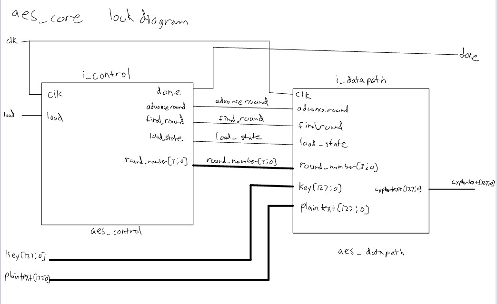
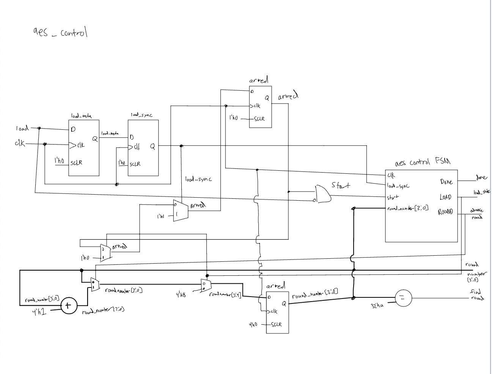
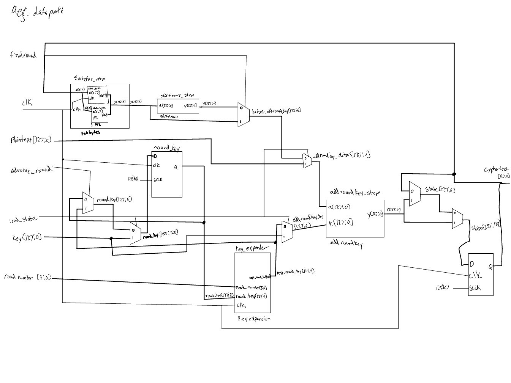
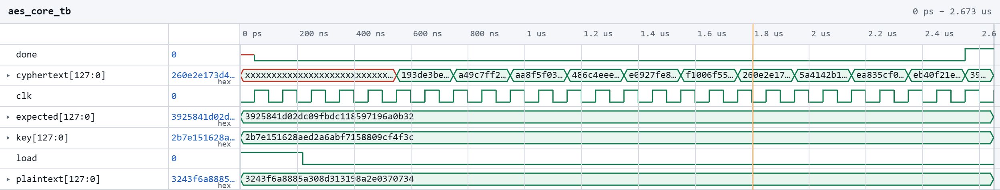
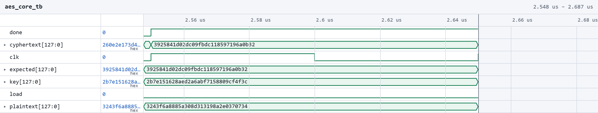
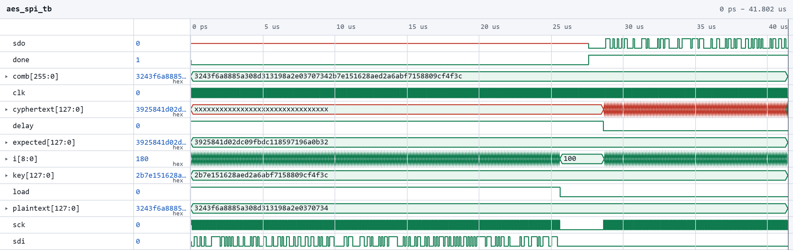
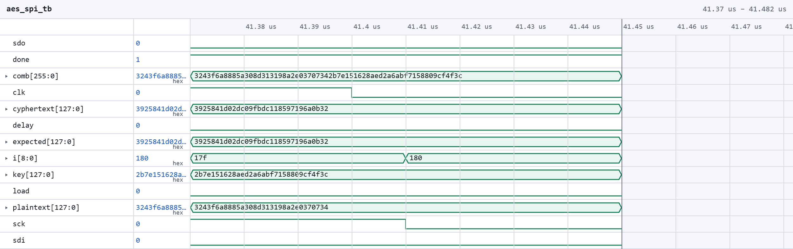
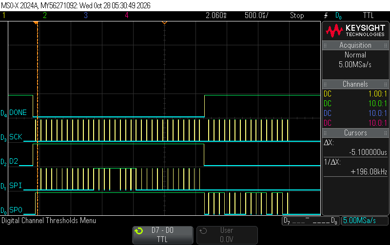

# Introduction

In this lab, a 128-bit AES encryption accelerator was designed in SystemVerilog for the FPGA. 
The design accepts a 128-bit plaintext and a 128-bit encryption key, performs the ten AES encryption rounds,
and produces a 128-bit ciphertext. An SPI interface connects the FPGA accelerator to the microcontroller, 
allowing the microcontroller to transmit the plaintext and key and receive the encrypted result.

The design uses a sequential architecture to reduce the hardware resources required compared with implementing 
all ten rounds as one large combinational circuit.

# Design and Testing Methodology

The design was divided into a controller, a datapath, individual AES transformation modules, and an SPI interface.

The data path implements the following AES operations

* **AddRouondKey** :XORs the current state with the round key.
*SubBytes: Substitutes each of the 16 state bytes using the AES S-box.

* **ShiftRows**: Cyclically shifts each state row to the left by its row index.

* **MixColumns**: Performs Galois field arithmetic on each state column.

* **KeyExpansion**: Generates the next round key using rotation, S-box substitution, and the round constant.

The aes_control module manages the encryption sequence, while aes_datapath prefrms the transformations and stores the 
intermediate state and round key. The controller uses the IDLE, LOAD, SUBWAIT, ROUND, and DONE states to coordinate the operation.

the S-box is implemented as a synchronous ROM using sbox_sync.sv and sboox.txt. Because ROM has a one-clock cycle read latency,
the SUBWAIT state alloows the substituted bytes and key-expansion results to become avaible befre the next round is executed. The final 
round omits MIxCOlumns as specified by AES.

THe SPI interfacte in aes_spi.sv recieves the 256 input bits with the plain text and key and shifts out the
128-bit ciphertext after the encryption completes. The interface uses SPI mode 0 with a low idle clock and data sampled on the rising edge

# Technical Documentation

the source code for the design is included in the lab7 project files on github

## Block Diagram

The following block diagrams show the hierarchy of the implementation and the moodules interfaces and connections.

{#fig-schematic fig-align="center"}

The top-level aes module instantiates the HSOSC oscillator, aes_spi, and aes_core. The oscillator supplies the clock for the AES core. 
The SPI interface handles serial communication, while the core performs encryption and signals completion through done.

{#fig-schematic fig-align="center"}

The controller generates the control signals that determine when the state is loaded and when each round advances. 

{#fig-schematic fig-align="center"}

The datapath contains the intermediate state and round-key registers, the AES transformation modules, and the feedback path that stores 
each round's result. During the final round, the datapath bypasses MixColumns.

# Results and Discussion

## Testbench Simulation

{#fig-schematic fig-align="center"}

{#fig-schematic fig-align="center"}

The core testbench applies the FIPS-197 test vector with key 2B7E151628AED2A6ABF7158809CF4F3C and plaintext 3243F6A8885A308D313198A2E0370734. 
The expected ciphertext is 3925841D02DC09FBDC118597196A0B32.

{#fig-schematic fig-align="center"}

{#fig-schematic fig-align="center"}


The full-system testbench exercises the serial input and output path in addition to the AES core. It sends the test vector over SPI, waits for 
encryption to complete, and captures the returned ciphertext.

## SPI communication with Logic analyzer

{#fig-schematic fig-align="center"}


The AES accelerator was tested on the physical FPGA using SPI communication with the MCU. The logic analyzer captured SCK, SDI, SDO, LOAD, and DONE to 
verify the input transaction, encryption completion, and ciphertext transmission. The MCU sent the 128-bit plaintext and 128-bit key to the FPGA, 
which performed AES encryption and returned the 128-bit ciphertext over SPI. The received ciphertext matched the expected result,
3925841D02DC09FBDC118597196A0B32, turning on PA9 confirming that the hardware completed the full transaction successfully.

# Conclusion

the AES is organized into individual modules with encryption transformations, a sequential datapath, a FSM controller, and an SPI interface. 
It is meant to preform all ten rounds of AES-128 encryption while accounting for the synchronous S-box read latency. All of the specs have been met and
the system is working

Total time spent: 15 hours

# AI Prototype Summary

<details>
<summary>Expand to view the LLM-generated code for KeyExpansion logic described in the FIPS-197 uploaded document</summary>

```SystemVerilog
module aes_key_expansion_128 (
    input  logic [127:0] prev_key,   // Input 128-bit key from previous round (w[i-4] .. w[i-1])
    input  logic [3:0]   round,      // Current round index (1 to 10)
    output logic [127:0] next_key    // Output 128-bit key for next round
);

    // Break previous key into 32-bit words w0, w1, w2, w3
    logic [31:0] w0, w1, w2, w3;
    assign {w0, w1, w2, w3} = prev_key;

    // Intermediate word signals
    logic [31:0] rot_word_out;
    logic [31:0] sub_word_out;
    logic [31:0] rcon;
    logic [31:0] temp;

    // Next key words
    logic [31:0] w4, w5, w6, w7;

    // 1. Instantiate RotWord and SubWord modules
    // RotWord: Performs a cyclic left shift of 1 byte on the input word
    RotWord rot_inst (
        .in (w3),
        .out(rot_word_out)
    );

    // SubWord: Applies the AES S-Box substitution independently to each of the 4 bytes
    SubWord sub_inst (
        .in (rot_word_out),
        .out(sub_word_out)
    );

    // 2. Lookup table for Round Constant (Rcon[round], 0, 0, 0)
    always_comb begin
        case (round)
            4'd1:  rcon = 32'h01_00_00_00;
            4'd2:  rcon = 32'h02_00_00_00;
            4'd3:  rcon = 32'h04_00_00_00;
            4'd4:  rcon = 32'h08_00_00_00;
            4'd5:  rcon = 32'h10_00_00_00;
            4'd6:  rcon = 32'h20_00_00_00;
            4'd7:  rcon = 32'h40_00_00_00;
            4'd8:  rcon = 32'h80_00_00_00;
            4'd9:  rcon = 32'h1B_00_00_00;
            4'd10: rcon = 32'h36_00_00_00;
            default: rcon = 32'h00_00_00_00;
        endcase
    end

    // 3. Key Expansion combinational logic
    assign temp = sub_word_out ^ rcon;

    assign w4 = w0 ^ temp;
    assign w5 = w1 ^ w4;
    assign w6 = w2 ^ w5;
    assign w7 = w3 ^ w6;

    // Pack the generated words into the output 128-bit key
    assign next_key = {w4, w5, w6, w7};

endmodule
```
</details>

<details>
<summary>Expand to view the LLM-generated code for KeyExpansion logic described by just logic</summary>

```SystemVerilog


module key_expansion #(
    parameter int Nk = 4,             // Number of 32-bit words in the key
    parameter int Nr = 10,            // Number of rounds
    parameter int TOTAL_WORDS = 4 * Nr + 4 // Total number of words generated
)(
    input  logic [Nk*32-1:0]        key,  // Concatenated key input: key[0], key[1]...
    input  logic [32-1:0]           Rcon [TOTAL_WORDS/Nk], // Rcon array indexed by i/Nk
    output logic [TOTAL_WORDS*32-1:0] w_flat // Output concatenated array w
);

    // Array of 32-bit words representing w[0] through w[4*Nr + 3]
    logic [31:0] w [0:TOTAL_WORDS-1];

    // Pack output array into flat vector
    generate
        for (genvar idx = 0; idx < TOTAL_WORDS; idx++) begin : g_pack_out
            assign w_flat[idx*32 +: 32] = w[idx];
        end
    endgenerate

    // ------------------------------------------------------------------------
    // Step 1: Initialize the first Nk words directly from the input key
    // ------------------------------------------------------------------------
    generate
        for (genvar i = 0; i < Nk; i++) begin : g_init_key
            // Slice key into 4-byte (32-bit) words: key[4*i .. 4*i + 3]
            assign w[i] = key[i*32 +: 32];
        end
    endgenerate

    // ------------------------------------------------------------------------
    // Step 2: Generate remaining words (w[Nk] to w[4*Nr + 3]) sequentially
    // ------------------------------------------------------------------------
    generate
        for (genvar i = Nk; i < TOTAL_WORDS; i++) begin : g_expand_key

            logic [31:0] temp;
            logic [31:0] mod2_out;
            logic [31:0] mod1_out_branch1;
            logic [31:0] mod1_out_branch2;

            if (i % Nk == 0) begin : g_mod_zero
                // Condition 1: i mod Nk == 0
                // temp = module1(module2(w[i-1])) ^ Rcon[i/Nk]
                module2 u_module2 (
                    .in  (w[i-1]),
                    .out (mod2_out)
                );

                module1 u_module1 (
                    .in  (mod2_out),
                    .out (mod1_out_branch1)
                );

                assign temp = mod1_out_branch1 ^ Rcon[i / Nk];

            end else if ((Nk > 6) && (i % Nk == 4)) begin : g_mod_four
                // Condition 2: Nk > 6 and i mod Nk == 4
                // temp = module1(w[i-1])
                module1 u_module1 (
                    .in  (w[i-1]),
                    .out (mod1_out_branch2)
                );

                assign temp = mod1_out_branch2;

            end else begin : g_default
                // Default condition: temp = w[i-1]
                assign temp = w[i-1];
            end

            // w[i] = w[i-Nk] ^ temp
            assign w[i] = w[i-Nk] ^ temp;

        end
    endgenerate

endmodule
```
</details>

After generating code with an LLM that had access to the FIPS-197 specification against code generated from pseudocode
without the full specification. The first implementation was specific to AES-128 and calculated the next round key using RotWord, SubWord, and round constants.
The second used parameters and generate loops to produce a more general key expansion module there's no RotWord or SubWord and it's just generic mdules and the indexed round constants aren't there either. 

Ths experiment showed that witholding the full specs doesn't prevent the LLM from generating useful code when pseudocode still describes the algrithm in detail.
However, generated code can contain assumptions about the order and indexing that needs to be confimred. This is interesting becasue it can help lmit the information shared
while still getting some guidance but we must be careful becuase it coould still reveal some important design details.